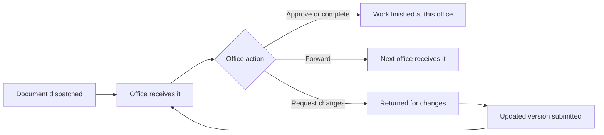
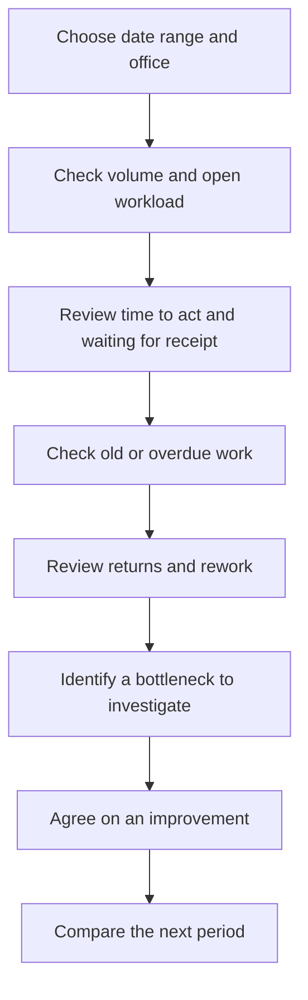

# Bureau and Office Work Efficiency Plan

## Purpose

Use DOTS workflow history to understand how work moves through each office, where it waits, and where documents are returned for more work. The goal is to find bottlenecks and support improvement, not to rank offices by raw document counts.

## How a document moves

Some routes send a document to several offices at once. In that case, measure each office's route step separately. A document is not the same as a unit of work for every office.

## Measures to start with

| Measure | Calculation | What it helps show |
| --- | --- | --- |
| Work completed | Count of route steps completed by an office during the period | Work volume |
| Time to act | Decision or forwarding time minus receipt time | How long work stays with the office |
| Waiting for receipt | Receipt time minus dispatch time | How long delivery waits for acknowledgement |
| Open workload | Number of active route steps currently assigned to the office | Current workload |
| Age of open work | Current date minus receipt date for active steps | How long current work has been waiting |
| On-time rate | Items acted on within the agreed target divided by items due | Whether agreed service targets are met |
| First-pass approval rate | Items approved without a change request divided by items decided | How often a submission is complete on first review |
| Return or rework rate | Items returned for changes divided by items reviewed | Where repeated work may be occurring |

For processing times, show the **median** and **90th percentile** as well as the average. The median shows a typical case; the 90th percentile helps reveal slow cases.

## How to read the results

Use these views to ask practical questions:

- Is work waiting before an office receives it, or after receipt?
- Is the backlog growing or getting older?
- Do particular document types take longer?
- Are many items returned for changes?
- Did processing time or backlog improve after a process change?

## Suggested dashboard filters

- Date range
- Bureau and office
- Document type
- Urgency
- Route status

Compare offices over time and within similar document types. Avoid comparing raw totals between offices with different workloads or staffing.

## Data checks before using the measures

1. Confirm that dispatch, receipt, decision, forwarding, and change-request events have reliable timestamps.
2. Confirm that office assignments and bureau groupings are current and historically meaningful.
3. Decide how to handle paused routes, parallel steps, reopened work, and missing timestamps.
4. Agree on service-time targets by document type and urgency before calculating an on-time rate.
5. Decide whether staff counts are reliable enough to report workload per staff member. Do not use this measure without accurate staffing data.

DOTS records workflow events, so it measures recorded process time. It does not measure how many minutes staff spent actively working on a document, and it may not include waiting or work that happened outside DOTS.

## Suggested rollout

1. **Start with a baseline:** report volume, time to act, open workload, and aging work.
2. **Check data quality:** review sample records with participating offices and correct event-recording gaps.
3. **Add rework measures:** include first-pass approval and return rates once decision data is consistent.
4. **Set targets:** have business owners agree on service targets for each relevant document type.
5. **Review changes:** compare results over time and use them to investigate process issues, not as standalone staff performance scores.

## Decisions for review

- Which offices and bureaus should be included?
- Which document types need separate targets?
- What counts as completed work for each office?
- Who can view office-level and bureau-level results?
- Should the reports be view-only, downloadable, or both?
