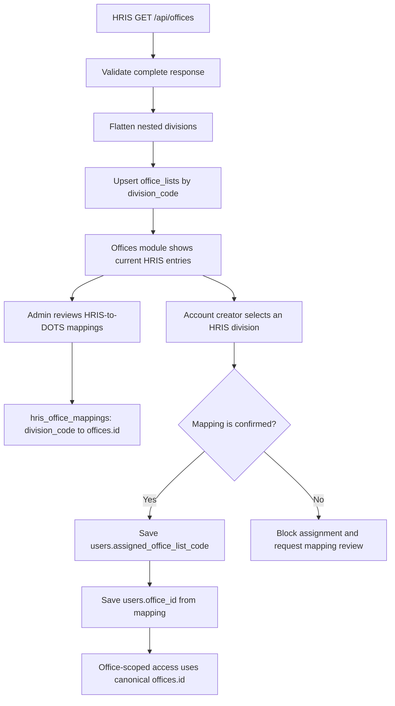

# HRIS Office Sync and Assignment: Implementation Approach

## Objective

Let administrators and account creators use the current HRIS office directory while keeping DOTS authorization and document history attached to the correct operational office ID.

The key rule is: **show the HRIS directory entry; assign the mapped DOTS `offices.id`.** Never use an `office_lists.id` as `users.office_id`.

## Current data and mapping status

- `office_lists` is the directory table; its `division_code` is the source identifier used for sync and mapping.
- `offices` is the legacy/current operational DOTS table. Its primary keys are referenced by users and document workflow records.
- The configured database currently has 269 active `office_lists` rows and 293 operational `offices` rows.
- `hris_office_mappings` has been created. The scan inserted 2 exact-code candidates as `auto_confirmed` and 32 unique full-name candidates as `pending_review`. The other 235 active directory rows have no unique exact code/full-name match.
- `DIV-4824` is currently a pending candidate for `offices.id = 21` (`CO-OPPR-ICTD`). It is not yet an approved mapping and must not drive account assignment.
- The sync command and Offices > HRIS Directory review interface are implemented. The initial reviewed mapping data remains 2 `auto_confirmed` and 32 `pending_review` rows; `DIV-4824` remains pending for `offices.id = 21` until an authorized reviewer confirms it.
- Schema migrations are applied locally. No live HRIS sync has been run, and no existing user assignments or operational office rows were bulk changed.

## Data boundaries

| Data | Table | Role |
| --- | --- | --- |
| Current HRIS office/division entry | `office_lists` | Current directory labels and source codes |
| DOTS office identity | `offices` | Canonical ID for access, routing, and historical references |
| Link from HRIS entry to DOTS office | `hris_office_mappings` | Resolves HRIS `division_code` to canonical `offices.id` |
| User's access assignment | `users.office_id` | Stores only `offices.id` |
| Employee's HRIS-reported division | `users.division_code` | Preserves the division returned by employee lookup |
| User's selected directory office | `users.assigned_office_list_code` | Stores the selected HRIS division code for current office display |

The integer IDs in `office_lists` and `offices` are unrelated. Do not compare or copy them. Names are labels; do not use exact or fuzzy name similarity to approve mappings automatically.

## End-to-end flow

## Implementation stages

### Stage 1: Verify the HRIS roster contract

1. Confirm that the configured `/api/offices` endpoint returns the complete office roster when called without an employee-specific `division_code` filter.
2. Confirm response pagination, status/inactive semantics, and stability of office and division codes.
3. Confirm whether divisions are the correct account-selection unit or whether some HRIS parent offices should be selectable instead.
4. Keep the API token server-side. Treat the fixture as development data, not a production completeness guarantee.

**Gate:** Do not implement destructive reconciliation or declare missing entries removed until completeness and status behavior are confirmed.

### Stage 2: Sync the directory only

1. Fetch the complete roster server-side and validate its envelope and records before writing.
2. Flatten each parent office's divisions into directory entries.
3. Upsert `office_lists` by `division_code`; preserve the row ID where a matching code already exists. Mark codes missing from the last successful roster as not current, but retain their rows and mappings for history.
4. Store parent office code/name alongside each directory entry if the Offices UI needs to show the hierarchy. Add nullable source columns rather than overloading existing division fields.
5. Preserve locally maintained values that HRIS does not authoritatively provide. Do not delete rows missing from a response until HRIS removal semantics are known.
6. Track each sync's actor, start/end, status, and counts. A failed or partial fetch must leave the previous complete directory usable.

This stage does not create or change rows in `offices`, `users`, documents, routes, trails, or audit history.

### Stage 3: Review and maintain mappings

1. Add an **HRIS Directory** section to the existing Offices module; do not create another top-level module.
2. Show each HRIS code/name, parent office, mapped DOTS office, and mapping status.
3. Apply safe, verifiable code matches as `auto_confirmed` only when they identify the same organizational level. Keep name-derived candidates, including the current 32, as `pending_review`.
4. Let an administrator review a pending candidate and either confirm it, reject it, or choose a different operational office. Record reviewer and time.
5. If an entry has no legacy match, distinguish a genuinely new DOTS office from a renamed/reorganized legacy office or a non-routable division. Only after an administrator confirms it is a new operational office should the normal office-creation workflow create an `offices` row and the mapping point to its new ID.
6. Allow multiple HRIS divisions to map to one DOTS office only when explicitly intended. One HRIS `division_code` must have at most one active mapping.

**Assignment rule:** account creation may use only `auto_confirmed` or administrator-`confirmed` mappings. `pending_review` and `rejected` entries are not assignable.

### Stage 4: Use current HRIS choices for new accounts

1. Display entries present in the latest successful HRIS sync in the account form, with parent office and division code to disambiguate similar labels.
2. Submit the selected `division_code`, not `office_lists.id`, display name, or a browser-supplied `office_id`.
3. On the server, validate the directory entry and resolve its confirmed mapping.
4. In one transaction, create the user with:
   - `users.assigned_office_list_code` = selected HRIS code, for current HRIS directory display;
   - `users.division_code` = division reported by the employee lookup;
   - `users.office_id` = mapped canonical `offices.id`, for DOTS access and workflow.
5. If no confirmed mapping exists, reject the assignment and direct an administrator to the mapping screen. Do not silently create an operational office or guess by name.

The user can see the selected current HRIS office label by resolving `users.assigned_office_list_code` to `office_lists`. Authorization continues to use `users.office_id`. These are separate lookups for separate purposes.

### Stage 5: Keep existing users and documents stable

- Do not bulk-edit existing `users.office_id` or `users.legacy_office_id` during sync or mapping setup.
- Existing legacy ICTD users and documents stay attached to `offices.id = 21` if that is their current canonical ID.
- A new ICTD account must resolve to `office_id = 21` after `DIV-4824` is confirmed.
- New documents for that account use the same operational office ID, so office-scoped access includes legacy and new ICTD records.
- For existing users, use their `division_code` for the current HRIS label only when it is present and validated. If it is missing or ambiguous, retain their current operational-office display; do not infer their division from `office_id` alone.
- If a genuinely new operational office is created, its users and documents use its new ID. They do not inherit another office's legacy documents unless a separate, reviewed continuity decision maps them to the old office ID.

## Mapping table requirements

The existing `hris_office_mappings` table has the initial columns for:

- unique `division_code`;
- `office_id` foreign key to `offices.id`;
- `match_method` and `status`;
- mapping actor/time and review actor/time;
- optional review evidence/note.

Keep `auto_confirmed`, `pending_review`, `confirmed`, and `rejected` meanings explicit. The runtime resolver must reject every status except `auto_confirmed` and `confirmed`.

## Rollout and checks

1. Review the mapping candidates and confirm the correct organizational level for ICTD and other office/division cases.
2. Run one controlled directory sync and compare record counts and representative codes with HRIS.
3. Confirm the sync changed only `office_lists` and sync history.
4. Confirm account creation rejects unmapped divisions and never accepts an `office_lists.id` as an operational office ID.
5. Confirm a new account selecting confirmed ICTD stores `assigned_office_list_code = DIV-4824` and `office_id = 21` (only if that mapping is approved); `division_code` continues to reflect the employee lookup.
6. Confirm legacy users and document office references remain unchanged and that the new ICTD account can see the existing ICTD document set.
7. Roll out to other users only after the mapping review and access check are complete.

## Review items before production rollout

- Should selection be at the HRIS division level, parent office level, or vary by account/office type?
- Who is authorized to confirm mappings and create genuinely new operational offices?
- Which HRIS statuses make an entry selectable?
- Should existing user pages show HRIS division names, operational DOTS office names, or both?
- Verify the initial 2 exact-code and 32 normalized-name candidates, especially `DIV-4824`, before relying on them for account assignment.
