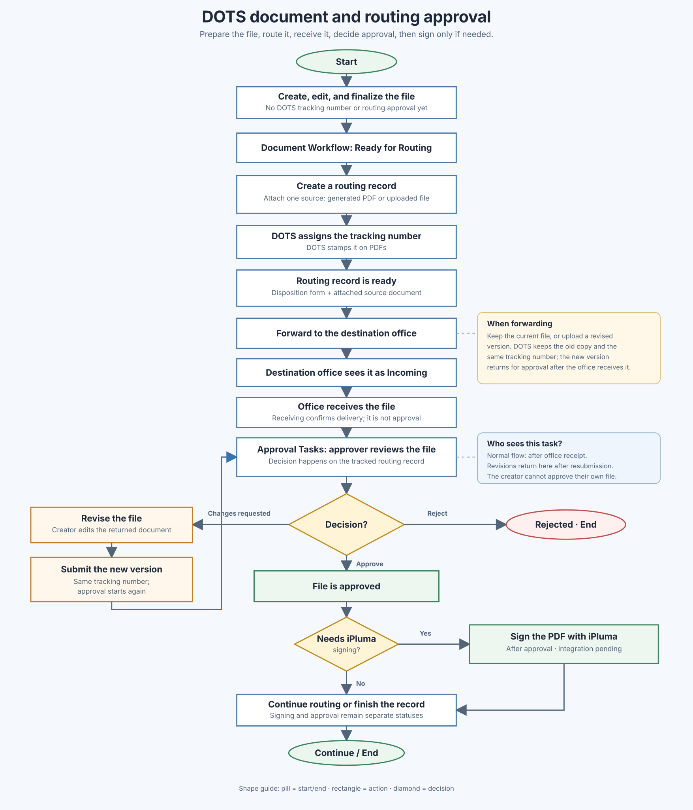

# DOTS Document and Routing Approval Workflow

**Purpose:** Describe the latest agreed workflow for generated and uploaded files, DOTS routing, office approval, and optional iPluma signing.

This workflow reflects the latest discussion: a generated file is prepared in Document Creation, then attached to a DOTS routing record. The approval decision happens on the tracked record in Tracking/Routing, after the receiving office receives it.

## The workflow in simple words

1. Create, edit, and finalize a document. It appears in Document Workflow as **Ready for Routing**. Finalizing it does not assign a DOTS tracking number or approve it for routing.
2. Create a routing record using that generated document, or upload a file. DOTS creates the tracking record, assigns its tracking number, and stamps that number on PDFs.
3. The disposition form is part of the routing record. The user attaches one source document to it: either the generated PDF or an uploaded file.
4. The current office forwards the record to the next office. It appears as incoming there.
5. Staff at that office receive it. Receipt confirms delivery; it is not approval.
6. After receipt, an eligible approver at that office sees it under **Approval Tasks** and can approve it, request changes, or reject it.
7. After approval, the office can continue routing the record. If a replacement file is uploaded during forwarding, that new version returns to awaiting approval.
8. If the PDF was marked as needing a signature, an authorized user signs it through iPluma after approval. Signing is separate from approval.

## Workflow image

## What the two files mean

- **Disposition form:** Part of the DOTS routing record. It reflects the tracking number, offices, actions, and routing history. The user does not attach a separate disposition-form file.
- **Source document:** The one content file attached to the routing record. It can be generated in DOTS or uploaded. This is the file offices review and approve, and the PDF that may be sent to iPluma.

The source document can have multiple versions over time. The earlier versions remain in the record history. All versions use the same DOTS tracking number.

## Approval Tasks: when a file appears

Approval Tasks is a decision queue, not a list of every document in routing. A tracked file appears there when:

- It is awaiting an approval decision.
- Its latest routing entry is pending at the user's office. In normal routing, this happens after the office receives the forwarded file.
- The user is an active administrator assigned to that office and is not the document's creator.
- The record is not archived or marked as legacy data needing review.

Receiving and approving are separate actions. If the page says **No tracked files are waiting for your approval**, no records currently match these conditions for that office.

## Forwarding with the current file or a new version

- **Keep current document:** Forward the existing source file as-is.
- **Upload new version:** Attach a corrected or updated file to the same tracking record. DOTS keeps the earlier version in history. If the replacement is a PDF, DOTS stamps it with the existing tracking number.
- Uploading a replacement returns the record to **Awaiting Approval**. The destination office receives the new version and an eligible approver must decide on it.
- If iPluma signing was already required, replacing the file marks the replacement as needing a signature again. The current Forward form does not let the user turn signing on for a record that was originally marked **Not required**.

## Optional iPluma signing

- At routing-record creation, the user can mark a PDF as **Needs iPluma signing after approval**. Non-PDF files cannot be sent to iPluma.
- This setting means the PDF needs a signature; it does not approve the document or start signing immediately.
- Approval happens first. If signing is required, an authorized user can then submit the approved PDF to iPluma.
- The signing state is separate from approval and routing state: for example, **Not required**, **Needs signing**, **Sent to iPluma**, or **Signed**.
- The iPluma PDF submission and signed-file return are not connected yet. The current **Sign with iPluma** button is disabled until that integration is implemented.

## Approval turnaround time

The routing approval interval can be measured from the receiving office's **Received** timestamp to the approver's **Approved** decision timestamp. Only completed decisions have a full interval. The dashboard's existing **Document Approval** chart still reads the older document-creation draft approval history, so it should be hidden or replaced before being used to report routing approval time.

## Current labels and responsibilities

| Page or area | Responsibility |
| --- | --- |
| **Document Creation** | Edit, preview, and finalize a generated file. No separate approval is part of the intended workflow here. |
| **Document Workflow** | List generated files that are ready for routing, track the creator's submissions, and show eligible approval tasks and approved records. |
| **Tracking/Routing** | Create tracking records, view files, receive and forward documents, record approval decisions, and show routing and signing status. |
| **Dashboard** | Show office work and reporting. Routing approval time should be based on routing history, not old document-draft review events. |

## Agreed workflow versus integration status

- The intended approval decision is on the tracked routing record, after the receiving office receives it.
- A finalized generated file is ready to attach; it is not a separate pre-approved routing submission.
- A file replacement keeps the same tracking number and returns that version to approval.
- iPluma signing remains a separate post-approval step. Its PDF submission and signed-file handling still need implementation.
- The whole-system workflow in `md/WHOLE_SYSTEM_WORKFLOW.md` still describes a separate authored-document approval path. It should be aligned with this workflow when that broader document is next revised.
