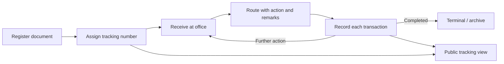

# DOTS System Feature Guide

**Document Tracking System (DOTS)**  
National Commission on Indigenous Peoples (NCIP)  
System review date: 28 October 2026

## Purpose and scope

DOTS is NCIP’s internal system for registering official documents, moving them between offices, recording actions, and checking where a document is in its lifecycle. It also provides a public tracking view and connects selected document information with PDMIS, DRIP, and iPLuma.

This guide is based on the active application modules, controllers, views, navigation, and the project’s technical notes. It describes functionality present in the codebase; it is not a live acceptance test of the deployed site. Archived dated copies of modules were treated as backups, not as separate current features.

## Who uses it and why

- **Document encoders and office staff** register documents, attach supporting files, receive and route work, and follow documents held by their office.
- **Managers and administrators** monitor document queues, see broader document records where their permissions allow, manage accounts and lookup lists, and review activity history.
- **Staff and external recipients with a tracking number** can use the public tracking page to view a document’s recorded routing history without signing into the internal interface.
- **Records and administrative personnel** use archives and the separate file repository to retrieve older records and uploaded files.

## Main workflow

1. A staff member creates a document record, classifies it, enters its title and purpose, and may save it as a draft or finalize it.
2. DOTS assigns a tracking number and can provide a QR code for quick access to tracking information.
3. An office receives the document, records receipt, and routes it to another office with an action and remarks. Supporting files can be attached during key actions.
4. Each transaction adds to the document trail. Staff can review the trail internally, while public tracking exposes a tracking view for the record.
5. When work is complete, the document can be tagged terminal/archived. Older records can be found through year-based archives.

## Functional areas

### 1. Sign-in, account recovery, and access control

- Username and password sign-in for internal users.
- After repeated failed login attempts, the login flow requires Google reCAPTCHA.
- Password recovery and reset flows are provided through email and reset links/tokens.
- The application checks that a session belongs to a signed-in user and ties the session to the request environment; invalid sessions return to sign-in.
- The navigation is permission-aware: selected administration links are shown according to the user’s assigned modules. Access to individual actions can also depend on role.
- The shared layout includes sign-out, a privacy notice, and a version/release-notes panel.

**Use:** Protect internal document actions and limit management tools to authorized staff, while retaining an unauthenticated route for public tracking.

### 2. Dashboard and work queue indicators

- Summary counters for **Pending**, **Incoming**, **Released**, and **Terminal** documents.
- Notification dropdown with counts for pending release, incoming items, items released today, and terminal-tagged items; entries lead to the dashboard.
- Dashboard-side incoming-document search endpoint.
- Counters load asynchronously after the page shell, so the interface can render before summary data returns.

**Use:** Give staff a quick view of the office’s workload and identify items awaiting receipt, action, release, or closure. The codebase does not provide a dedicated, historical analytics/reporting dashboard; broader analytics described in planning material should be treated as proposed work.

### 3. Document registration and management

The Documents and Latest Documents screens provide the main document-work interface. The active views and server-side DataTables support:

- Create a document with document type, purpose, origin, title, remarks, urgency/notification details, and related information.
- Save a record as a **draft** or **finalize** it.
- Generate a tracking number and present a QR code that can be downloaded for tracking.
- Browse and search records in a paginated table, with global and per-column search and configurable sort order.
- Apply advanced filters for document type, status, source, and date range, then reset filters.
- Export document results as CSV or PDF from the document listing flow.
- Open a document’s trail and review transaction remarks.
- Receive a document into the current office, release/route it to a selected office, and record remarks and an action.
- Add supporting attachments while registering or routing a document; the forms accept common office files and images, subject to the specific action’s allowed types.
- Mark a document terminal/archived, with remarks, an attachment, and notification to selected offices.
- Update a document title and delete a record where permitted.
- See overdue-document information in the document workflow.

**Use:** Keep document details and movement in one traceable workflow rather than relying only on separate email or paper hand-offs.

### 4. All-office document view

The `DocumentsAll` module supplies a broader document listing for administrative use, with server-side table operations and document actions similar to the main listing. It is not presented as a separate standard sidebar entry; its availability depends on configured access and routing.

**Use:** Allow authorized staff to inspect records beyond the ordinary office-scoped view.

### 5. Public document tracking

- Public route accepts a tracking number and shows the document’s recorded history in a timeline-style view.
- Uses a lightweight public layout rather than the signed-in administrative navigation.
- Can be reached from tracking information/QR workflows.
- Invalid or unavailable tracking numbers produce an error message rather than an internal document listing.

**Use:** Let a recipient or stakeholder check progress without an internal account. The public page is for a specific tracked document, not general browsing or system-wide search.

### 6. Archives

- Browse archived/terminal records across all available years or choose a year.
- Available archive years are used to populate the archive navigation dynamically.
- Archive tables support document lookup, sorting, and transaction-history review.
- Archive controllers retain document operations such as receiving, release/routing, title update, terminal tagging, and download where allowed by the page’s permissions and state.

**Use:** Find completed records by year while keeping them distinct from active work queues.

### 7. Audit trail

- Central activity listing with module, event, date/time, and staff member.
- Server-side search, column filtering, and sorting.
- Shared application logging records major user actions through a common trail helper.

**Use:** Support operational review and accountability by showing which user performed an action and when. This is an application activity log, not a guarantee that every database change is captured.

### 8. File Upload repository

- Separate uploaded-file listing with file type, size, description, upload date/by, receive date/by, and available actions.
- Upload and update metadata/files; download stored files.
- Upload form describes a maximum file size of 50 MB and a ZIP-only upload restriction for that repository.
- Stored under a dedicated `assets/uploads/DVSS/` path in the active controller.

**Use:** Maintain a retrievable shared repository for office file packages. This is separate from the attachments used directly on document registration and routing forms.

### 9. User account administration

- List accounts in a searchable table and create user accounts.
- Edit/update account information and retrieve account details.
- Account setup is associated with the user’s office and role/module access.
- New-account creation sends an email notification with account setup credentials according to the current implementation.

**Use:** Onboard staff and maintain the user directory and the access scope used by DOTS.

### 10. Reference libraries and setup

The Libraries navigation groups the reference data used in document capture and routing:

- **Office:** maintain office/bureau records and their identifying information.
- **Range:** manage routing range/scope definitions, such as agency or regional coverage.
- **Document Type:** maintain document classifications.
- **Purpose Type:** maintain purpose categories.
- **Action Type:** maintain actions available during routing or processing.
- **Setup:** a setup form and PDMIS connection/configuration helpers are present in the codebase; exposure is subject to deployment configuration.

**Use:** Keep form choices and organizational routing data consistent. Menu visibility for these screens is permission-dependent.

### 11. External system views and integrations

#### PDMIS

- Shows PDMIS document tracking information in a DOTS table.
- Includes a QR/disposition view and a path to the PDMIS public trail.
- A PDMIS API client/helper and configuration are present, with tracking/status/history/list operations and caching behavior documented in the project.
- An admin-oriented document-linking controller supports browsing linked/unlinked records, searching PDMIS records, connection checks, linking, and unlinking. Its routes/views are not all surfaced in the main navigation and availability should be confirmed in the deployment.

**Use:** Connect a DOTS record to the corresponding PDMIS tracking record and make related progress information easier to access.

#### DRIP

- Displays DRIP certificate records, with table search and paging.
- Certificate detail view includes tracking number, document type, completion/validation/verification states and times, approvers, and an available certificate file link.
- The DRIP API integration is configured separately from local document records.

**Use:** Check certificate workflow status and open the certificate from DOTS.

#### iPLuma

- Displays the iPLuma DOTS summary, including file name, originator, upload date, and signer information.
- Signing Trails view shows signer and signed-at details.
- Data is fetched from the iPLuma integration and presented in a searchable/paged table.

**Use:** Check uploaded/signing information associated with iPLuma without switching immediately to its separate interface.

### 12. Privacy and user-facing notices

- Privacy notice modal describes collection, use, sharing, retention, safeguards, and data-subject rights.
- User can acknowledge the notice; acknowledgement is kept in browser local storage, and the notice can be reopened from the sidebar.
- Version label opens release notes; the latest version displayed in the active layout is **2.26.07.20**.

**Use:** Make the privacy information and release notes accessible in the application shell.

## What is distinctive about DOTS

1. **Office-to-office chain of custody:** A document record is paired with a sequence of office transactions, giving staff a timeline of where it moved and what action was recorded.
2. **Tracking without an internal account:** A tracking number can be used to view a limited public trail, which is useful for status inquiries and recipients.
3. **Multi-system visibility:** DOTS places PDMIS, DRIP, and iPLuma records or status details beside its own document workflow, with PDMIS linking support in the codebase.
4. **Closure and historical retrieval:** Terminal tagging and year-based archives provide a defined path from active processing to retained records.
5. **Office-aware operations:** Dashboard queues and document access are designed around office and role context, while administrative views can cover broader records.
6. **Action-level context:** Routing and closure forms can capture remarks and attachments at the moment an action occurs, rather than only storing a file against a document with no transaction context.

## Navigation map

| Area | Main functions |
|---|---|
| Dashboard | Queue counters, notification counts, incoming search |
| Documents | Latest and all documents, create, search/filter, route, receive, trail, exports |
| Other Information System | PDMIS, DRIP, iPLuma views |
| Libraries | Office, Range, Document Type, Purpose Type, Action Type |
| User Account | Account administration |
| Archives | All years and year-specific archives |
| Audit Trail | User activity history |
| File Upload | Separate shared file repository (available through route/role configuration) |

## Availability and documentation notes

- The active sidebar links to **Reports** for users whose module list includes it, but this codebase’s active `application/modules` tree contains no `Reports` module. The link should therefore be considered an unverified or unavailable feature in this checkout.
- The active menu includes a `Range` link. Some older technical notes group it with Office setup; the current module has its own controller/view.
- `DocumentsAll` and PDMIS linking functionality exist in code but are not surfaced as ordinary top-level navigation entries. Their usability depends on deployment routes, permissions, and compatible schema/API configuration.
- The repository includes dated module snapshots and backup files. Those were not counted as separate current functionality.
- API-backed screens require working external service credentials/network access; their presence in the code does not confirm current external service availability.
- No application screenshots were added: the checkout contains branding and template images but no genuine screen captures, and a screenshot would require a running, authenticated application with representative data. This guide uses a workflow diagram instead.

## Technical overview

- **Application:** PHP with CodeIgniter 3 and HMVC modules.
- **Database:** MySQL/MariaDB through the CodeIgniter database layer.
- **Interface:** AdminLTE 3, Bootstrap 4, jQuery, and DataTables.
- **Supporting UI capabilities:** date-range and enhanced selectors, rich text input, notifications, PDF/CSV export, and QR-code generation are used in relevant screens.
- **Email:** PHPMailer is used for account and password-reset communications; document notifications are also part of routing/terminal workflows where configured.
- **Files and APIs:** local upload storage plus configured PDMIS, DRIP, and iPLuma integrations.

## Suggested quick reference

- **I need to register a new item:** Documents → Latest Documents → Add New Document; choose draft or finalize.
- **I need to find a record:** use the document search and filters, or choose Archives and a year for completed records.
- **I need to send it to another office:** open its release/routing action, select the receiving office, and record action/remarks; attach a supporting file if needed.
- **I need to see its history:** open the document trail, or use the public tracking view with its tracking number.
- **I need to close the work:** use the terminal/archive action and record the completion context.
- **I need to review who acted:** open Audit Trail.
- **I need status from another system:** use the PDMIS, DRIP, or iPLuma section, subject to service availability.

