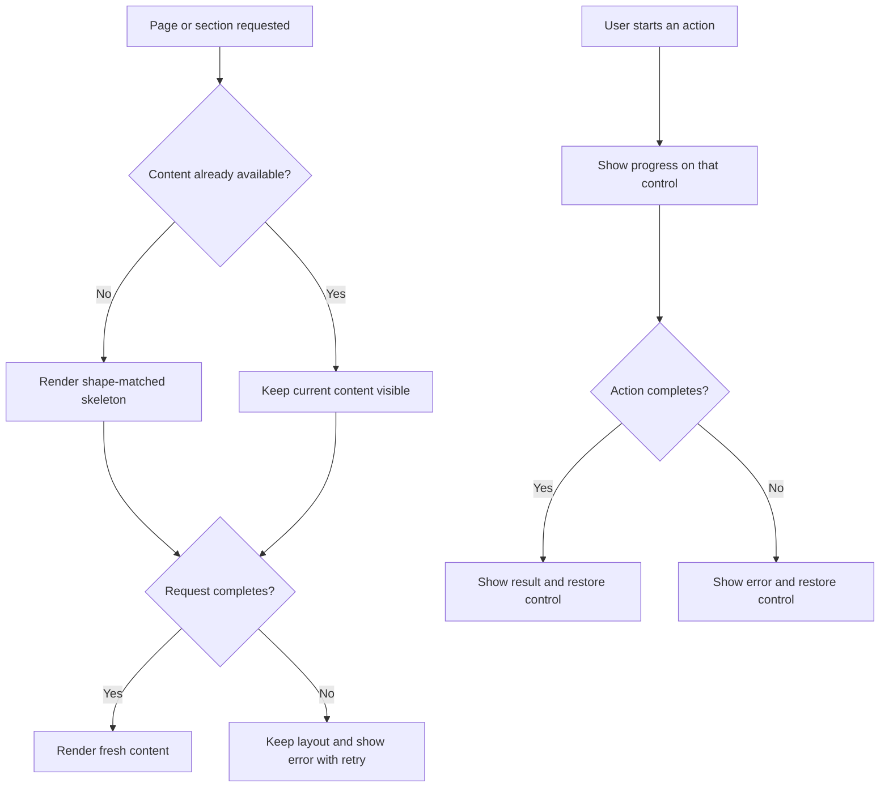

# Loading-state UI plan

## Goal

Show people that a slow part of the page is working while keeping already-loaded content useful. Loading indicators improve feedback; they do not reduce request time. The performance review remains the source for server timing and optimization work.

## Recommended pattern

- **Skeletons** for the first load of a page section when its final content is not available yet. Their shape should resemble the content they replace.
- **Inline progress** for updates to content already on screen, such as a search, filter, or page change. Keep the existing content visible and mark the changing region as busy.
- **Button spinner and label** for a user-triggered action such as opening a document or submitting a form. Disable duplicate submission while that action is in flight.
- **No indicator for very fast work.** Delay showing small spinners briefly (roughly 150–250 ms) to avoid flicker. Do not delay the actual request.

Avoid a full-page blocking spinner for normal navigation. It hides useful content and makes the application appear less responsive.

## Page-by-page plan

| Page or action | First load | Update/action | Placement and behavior |
| --- | --- | --- | --- |
| Dashboard summary | Skeletons only for any summary section that is genuinely deferred | Keep available cards visible | Match the card layout and reserve its height to prevent layout shift. |
| Dashboard charts and processing metrics | Chart-shaped skeletons in each deferred panel | Replace each panel when its own data arrives | Keep titles and panel boundaries visible. Add a short “Loading chart…” label for screen readers and visible context if useful. Show an error/retry state if the deferred request fails. |
| Documents and latest documents | Table-row skeletons only before the first result is loaded | Keep current rows visible during search, sorting, and pagination; show a small indicator beside the table controls or in the table caption | Mark the table region busy; do not blank the table. Prevent stale results from looking current by showing a subtle progress state until the new response arrives. |
| Archives and audit trail | Skeleton rows matching the table columns | Small inline progress while filters or pagination update | Keep column headers and table dimensions stable. |
| Document creation queue | Skeleton draft rows if the queue has not loaded | Button-level state for actions; inline state if the list refreshes | Verify with a populated queue before choosing the final skeleton row count. The measured local database had zero drafts. |
| Open, print, or forward a document | Keep the page visible; show a loading state in the document detail area if details are fetched | Spinner and action text on the triggering button, such as “Opening…” or “Preparing…” | Disable repeat clicks until completion; restore the button and show an error if the operation fails. |
| User accounts and offices | Use skeleton rows only if browser measurement shows a noticeable first-load delay | Inline progress for future search or pagination | Current server timings are short, so do not add persistent loading UI without evidence of a user-visible delay. |

## State flow



## Visual example

Dashboard while analytics are loading:

```text
+----------------------+  +----------------------+
| Incoming       128   |  | Pending          14  |  Summary already loaded
+----------------------+  +----------------------+
+------------------------------------------------+
| Document types                                 |
| [ chart-shaped skeleton bars                   ] |  Deferred panel
+------------------------------------------------+
+------------------------------------------------+
| Processing time                                |
| [ skeleton metric rows                         ] |  Deferred panel
+------------------------------------------------+
```

Documents while a search is updating:

```text
Search: "budget"  [small spinner] Updating…
+------------------------------------------------+
| Existing document rows remain visible          |  Region marked busy
| Existing document rows remain visible          |
+------------------------------------------------+
```

## Accessibility and interaction requirements

- Put `aria-busy="true"` on the region being updated, not the whole application.
- Give decorative skeletons `aria-hidden="true"`; provide a concise screen-reader status such as “Loading dashboard charts” or “Updating documents”.
- Keep keyboard focus on the control that initiated the update. Do not move focus when background data arrives.
- Respect `prefers-reduced-motion`; use a static skeleton or reduced animation when requested.
- Ensure skeleton colors have enough contrast and are not the only indication of progress.
- Preserve the table headers, panel titles, and page layout while data is changing.
- On failures, show a clear error and retry option instead of leaving an indefinite spinner.

## Implementation sequence

1. Check the existing Inertia loading/deferred-prop behavior and identify which sections actually render after navigation versus arrive later.
2. Add skeletons to dashboard analytics panels first; this is the clearest known multi-second wait. Ensure the fallback does not change the response or analytics calculations.
3. Add a delayed, inline busy indicator to document search, filtering, sorting, and pagination. Keep old rows visible until new props arrive.
4. Add table skeletons to audit and archives only if browser measurements show a visible first-load wait. Add button-level progress to document actions where the request is asynchronous.
5. Check responsive layouts, reduced-motion behavior, keyboard navigation, and error/retry states.

## Validation and measurement

- Compare the same route, account role, office, filters, and data before and after the UI change.
- Use browser Network and Performance panels to record request duration, transfer size, and time until usable content appears. Repeat several times and compare medians.
- Confirm that skeletons disappear on success and failure, existing data remains visible during updates, and repeated clicks do not submit duplicate actions.
- Verify screen-reader status, keyboard focus, reduced-motion preference, and narrow-screen layouts.
- Keep perceived loading feedback separate from actual speed measurements: a spinner must not be reported as a performance improvement by itself.

## Out of scope for this UI pass

Loading UI does not resolve the remaining server-side dashboard analytics delay (about 3.42 seconds in the current one-pass measurement). Continue to profile its SQL and query plans as described in [the performance review](performance-review-and-fix-plan.md). Also measure external integrations separately because their network wait is not represented by local database timing.

## Implementation status

The first UI pass is now applied in the React pages:

- Cross-page Inertia GET navigations show a centered spinner after a 250 ms delay; the existing top progress bar remains enabled. Same-page visits such as searches and filters continue to use their local indicators.
- Dashboard analytics render chart-shaped skeleton panels until the deferred analytics prop arrives. When changing the chart office, existing chart content remains visible and an inline spinner/status indicates the refresh.
- Documents and latest documents keep current table rows visible during server search, filtering, sorting, and pagination. A spinner appears after a short delay, and the table region exposes its busy state to assistive technology.
- Archive and audit filter/pagination interactions show inline progress while retaining the current rows.
- Document detail and forwarding dialogs show an inline spinner while transaction history or attachments are fetched. Existing saving states continue to label document-creation actions.
- The implementation uses CSS animation and the existing `lucide-react` icon package; it adds no dependencies or image assets.

The actual pages still need a browser review for visual fit, mobile layout, reduced-motion behavior, keyboard/screen-reader feedback, and request failures. Initial skeletons are limited to the deferred dashboard analytics; the other pages receive their data in the Inertia response and show progress only during an in-place update.
