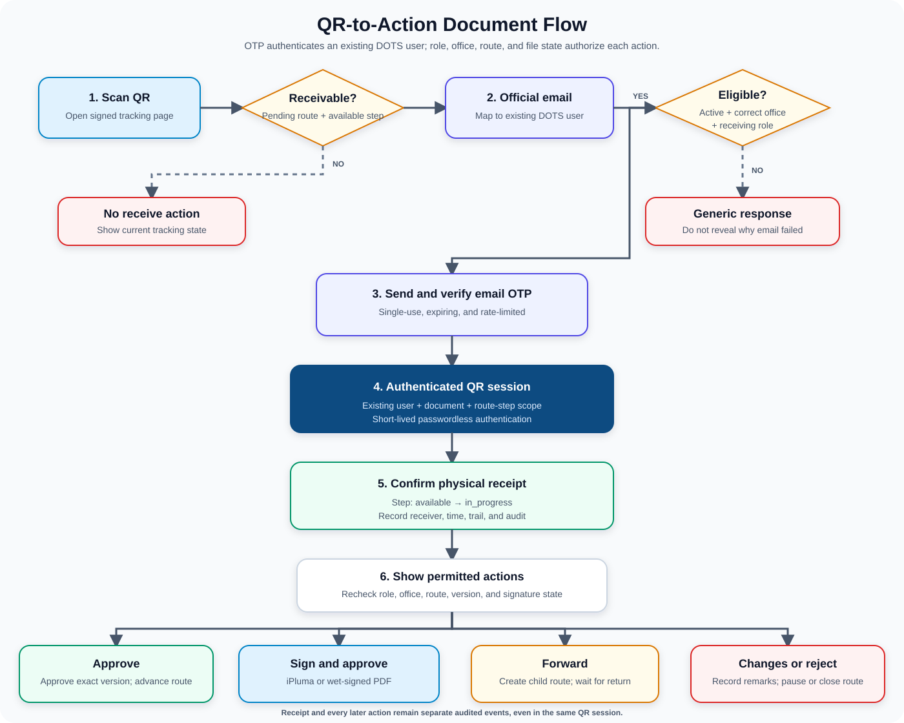
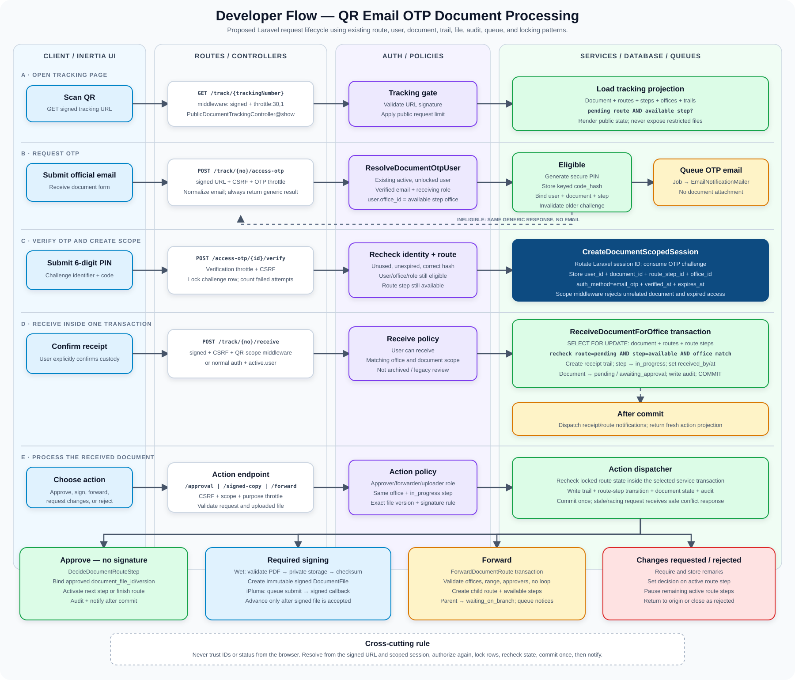

# QR, Email OTP, and Document Processing Plan

> **Implementation status:** The testable QR OTP workflow is implemented. Use the [step-by-step testing guide](./qr-email-otp-document-workflow-testing-guide.md) to verify receiving, approval, wet signing, forwarding, and security restrictions.

**Status:** Testable MVP implemented  
**Date:** October 24, 2026  
**Scope:** Receive and process a routed physical document from its QR tracking page by authenticating an existing DOTS user through an official-email one-time PIN (OTP)

## Goal

Make office receipt and follow-up action faster without allowing anyone who scans a document's QR code to receive, approve, sign, forward, reject, or return it.

The QR code identifies the document and opens its signed public tracking page. It does not authorize an action. A normal DOTS login or a verified one-time PIN establishes the user's identity; DOTS then authorizes each action from the user's stored role, office, and the document's current route state.

## Recommended decision

Use a hybrid, passwordless document-processing flow:

- A logged-in eligible employee may receive the document directly after server-side confirmation.
- A user who is not logged in may authenticate through an email one-time PIN (OTP).
- The submitted email must already belong to an active, unlocked DOTS user assigned to the office currently expected to receive the document.
- The user must not be allowed to enter a free-form name, office, or unregistered personal email as proof of identity.
- Successful OTP verification creates a short-lived, document-scoped authenticated QR session. It is a passwordless login for the scanned document, not unrestricted access to all DOTS pages.
- The session may record physical receipt and then offer approval, signing, forwarding, rejection, or request-for-changes actions only when the matched DOTS user's role permits them.
- Receipt and approval remain separate audit events even when the same approver performs them one after the other.
- A required iPluma or wet signature must be completed according to policy before the route advances.
- A wet-signed primary document must be scanned as a readable PDF and stored as a new immutable version. The scanner and upload device may be a phone, desktop, or office scanner.

This keeps the experience mobile-friendly without making a phone mandatory for scanning or uploading, while preserving office authorization and a reliable audit trail.

## Visual flow



## Simple end-to-end flow

```text
Scan QR
    |
Open signed public tracking page
    |
Is there a pending route with an available step?
    |-- No --> Show current tracking state; no receive action
    |
    `-- Yes --> Enter registered official email
                    |
                Resolve existing DOTS user
                    |
                Check active account + office + receiving role
                    |
                Send and verify OTP
                    |
                Create short-lived document-scoped session
                    |
                Confirm physical receipt
                    |
                Route step: available -> in_progress
                    |
                Show only permitted actions
                    |
        +-----------+-------------+----------------+----------------+
        |                         |                |                |
     Approve                  Sign first       Forward      Changes/reject
        |                         |                |                |
  No signature?          iPluma or wet PDF   Create child      Pause/close
        |                         |             route          active route
        `----------- Complete required signing -----------+
                                  |
                           Record approval
                                  |
                      Next step becomes available,
                      or route becomes approved
```

## Status guide

`pending` on the route and `available` on a route step have different meanings.

| Record | Status | Meaning |
| --- | --- | --- |
| Route | `pending` | The overall route is active. This alone does not mean an office may receive. |
| Route step | `waiting` | It is not yet this office's turn. |
| Route step | `available` | The document was dispatched to this office and is waiting for physical receipt. |
| Route step | `in_progress` | The office received the document and may now review or act on it. |
| Route step | `waiting_on_branch` | The office forwarded the document and is waiting for the child route to finish. |
| Route step | `approved` | The office completed its approval. |
| Route step | `changes_requested` | The document was returned for correction. |
| Route step | `rejected` | The office rejected the document. |

A route step is receivable only when the route is `pending`, the step is `available`, and the verified user's `office_id` matches the step's `office_id`. For a sequential route, every earlier step must also be approved.

## Existing behavior to preserve

DOTS already has most of the routing rules needed for this feature:

- The disposition-form QR code opens a signed public tracking URL.
- The public tracking page shows the document's route and activity timeline.
- A route step becomes receivable only when its status is `available`.
- The authenticated receive endpoint checks that the user has a permitted operational role and belongs to the expected office.
- Receipt changes the route step to `in_progress`, records `received_by` and `received_at`, creates a document trail, and creates an audit entry.
- A database transaction and row locks protect the existing receipt operation from concurrent updates.

The OTP flow should reuse the same receiving service and business rules. It must not introduce a separate, weaker version of document receipt.

## Roles and responsibilities

### Receiver

The receiver confirms that the physical document reached the expected office. A receiver may be an Executive, Admin Staff member, Encoder, designated receiving clerk, or another role explicitly authorized by policy.

The receiver does not automatically become the document approver. OTP proves the identity of an existing DOTS user; it does not grant that user a new role.

### Approver

The approver reviews the document and submits an approval decision, rejection, or request for changes. An eligible approver may perform these actions through either a normal DOTS login or the short-lived document-scoped QR session created by email OTP.

If the same DOTS user has both receiving and approval permission, that user may receive the physical packet and then process it in the same QR session. Receipt and decision are still stored as separate events.

### Forwarder

An authorized user may forward an `in_progress` document to another eligible office when further action is needed before the current office decides. Forwarding creates a child route and changes the current step to `waiting_on_branch`; it is not the same as approving and advancing to the next predefined step.

### Office administrators

Administrators maintain or synchronize the list of active DOTS users, office assignments, verified official email addresses, and roles allowed to receive, approve, forward, upload signed copies, or verify signed copies.

## Proposed user flow

### 1. Scan the QR code

The user scans the existing QR code on the disposition form and opens the signed public tracking page.

### 2. Determine whether receipt is currently allowed

The server finds the active route steps for the document.

- If no step is `available`, do not show an actionable receive control.
- If one or more route steps are `available`, show **Receive document**.
- In a parallel route, the receiving request must resolve to the office associated with the verified employee. The user must not select an arbitrary office.
- If the document is archived, terminal, under legacy review, already received, or otherwise unavailable, reject the request.

### 3. Start receipt

When the user selects **Receive document**:

#### Authenticated user

The server confirms that the current user:

- is active and not locked;
- has an authorized receiving role;
- has a valid office assignment; and
- belongs to an office with an `available` route step for the document.

If every check passes, show a confirmation dialog and use the normal authenticated receive operation.

#### User without a session

Show a small verification form asking for an official email address. Do not ask the user to select an office or type a receiver name.

After submission, the server checks whether the email belongs to an existing eligible DOTS user for the document's active office step. The lookup is:

```text
submitted email
    -> users.email
    -> users.id
    -> users.office_id
    -> users.role_id / role
    -> matching available route step
```

For usability, return an actionable validation error when the lookup fails:

- no matching `users.email`: tell the user that the email is not registered in DOTS;
- matching user but inactive, locked, assigned to another office, unauthorized by role, or outside the active route step: tell the user that the account is not eligible for the current route step; and
- matching and eligible user: confirm that the verification PIN was sent.

Keep the user on the email form after either validation error. This intentionally favors internal-user usability over account-enumeration resistance; compensate with signed tracking URLs and strict request throttling.

### 4. Send the OTP

If the DOTS user is eligible, email a six-digit one-time PIN. The email should contain:

- DOTS tracking number;
- document title or a privacy-safe label;
- expected receiving office;
- PIN expiration time;
- warning not to share the PIN; and
- a note that verification creates a temporary session for the scanned document and that receipt still requires confirmation.

The OTP email should not contain the document file or confidential document content.

### 5. Verify and create a document-scoped session

The user enters the PIN on the public tracking page. The server validates the challenge and creates a short-lived authenticated session scoped to the resolved DOTS user, scanned document, and matching route step.

Recommended session behavior:

- valid for 15 to 30 minutes;
- no `Remember me` behavior;
- no access to unrelated documents, profile changes, user administration, or system settings;
- invalidated when the route changes materially, the account becomes ineligible, the user signs out, or the session expires; and
- server-side authorization repeated for every action.

### 6. Confirm and record physical receipt

Show a receipt confirmation. When the user confirms, recheck the document, route, user, office, and step inside the receipt transaction.

If still valid, the system:

- marks the matching route step `in_progress`;
- records the resolved existing DOTS user as `received_by`;
- records the receipt time;
- creates the normal document trail;
- creates an audit entry identifying email OTP as the authentication method;
- invalidates all outstanding OTP challenges for that route step; and
- shows the post-receipt action page.

If another employee has already received the same step, the receipt request must fail safely and the page should show that the document is no longer waiting for receipt.

### 7. Show role-authorized actions

After receipt, show the exact primary file/version, supporting files, route state, and signature requirement. Then show only the actions permitted for the verified DOTS user:

- **Review and approve** when no signature is required;
- **Sign with iPluma** when electronic signing is required;
- **Upload signed PDF and approve** when wet signing is required;
- **Forward to another office** when the role and route allow forwarding;
- **Request changes**; or
- **Reject**.

A receiving-only user sees the receipt confirmation but does not see approval or forwarding actions.

### 8. Complete the selected action

#### Approve without signing

The approver reviews the physical packet and the exact primary file/version in DOTS, confirms the decision, and approves. The system records the approved file/version and activates the next route step or completes the route.

#### Sign with iPluma

DOTS sends the exact primary PDF to iPluma and keeps the route step in progress until the signed PDF returns and passes validation. The signed PDF is stored as a new immutable version before the route advances.

#### Wet-sign, scan, upload, and approve

The approver signs the physical primary document. The complete signed document is scanned as a readable PDF using an appropriate phone, desktop, or office-scanner workflow. The PDF may be uploaded from any supported device. After preview and confirmation, DOTS stores it as a new immutable signed version, records approval, and advances the route.

An ordinary blurry photo should not become the official signed copy. The PDF should preserve the complete document, correct page order, and readable signatures, dates, initials, stamps, and annotations.

#### Forward

An authorized user selects the receiving office or offices, enters instructions, chooses sequential or parallel routing when permitted, and may attach a new immutable version. DOTS creates a child route and changes the current step to `waiting_on_branch`. When the child route completes, the current office returns to `in_progress` and makes its final decision.

#### Request changes or reject

The user enters the required remarks. DOTS records the decision and pauses or closes the affected active route steps according to the existing routing rules.

## Authorization rules

Creating an actionable QR session and receiving through it are allowed only when all of the following are true:

1. The QR URL has a valid signature.
2. The document is finalized, active, and not archived or marked for legacy review.
3. The document has a route step with status `available`.
4. The submitted email exactly matches a registered and verified existing DOTS user.
5. The employee is active, not locked, and assigned to the office on that available step.
6. The employee's role is allowed to receive documents.
7. The OTP challenge is unused, unexpired, and within its attempt limit.
8. The route step is still `available` when the final database transaction begins.

Possession of the QR code, knowledge of the tracking number, or access to the public tracking page is never sufficient authorization.

After receipt, every action must recheck the account, document, route, office, and role. In addition:

- approval, rejection, and requests for changes require an eligible approver at the matching `in_progress` office step;
- forwarding requires explicit forwarding permission and a valid target office;
- approval must identify the exact primary file/version being approved;
- a wet-sign-required document must have the required signed PDF before the route advances;
- an iPluma-required document must not advance until the signed PDF is returned and accepted; and
- the scoped session must still match the user, document, and route step.

## OTP security controls

- Use a cryptographically secure random six-digit PIN.
- Store only a keyed hash of the PIN; never store the readable PIN.
- Expire challenges after 5 to 10 minutes.
- Allow no more than five verification attempts per challenge.
- Make each challenge single-use.
- Invalidate earlier challenges when a new PIN is issued for the same email and route step.
- Consume the verified challenge when it creates the document-scoped session.
- Invalidate every competing challenge after a successful receipt.
- Rate-limit PIN requests by document, route step, email hash, session, and IP address.
- Rate-limit verification attempts by challenge and IP address.
- Add a short resend cooldown, such as 60 seconds.
- Return distinct registration and eligibility errors for usability, while rate-limiting the endpoint because this exposes limited account-registration information.
- Do not log readable OTP values or complete email addresses.
- Record suspicious repeated failures in application security logs.
- Rotate the session identifier after successful OTP verification.
- Treat successful OTP verification as verification of the registered email address and fill an empty `users.email_verified_at` value.
- Bind the session to the resolved `user_id`, document, and route step; never trust identifiers submitted by the browser.
- Protect state-changing actions with CSRF and the same server-side policies used by normal authenticated routes.
- Give the scoped session no access to unrelated documents or account-management pages.

Recommended starting limits:

| Control | Initial value |
| --- | --- |
| OTP length | 6 digits |
| OTP validity | 10 minutes |
| Verification attempts | 5 per challenge |
| Resend cooldown | 60 seconds |
| PIN requests | 5 per document/email per hour |
| Verification requests | 10 per IP per minute, plus challenge limit |
| Document-scoped session | 20 minutes |

These values should be configurable and reviewed after observing legitimate office usage.

## Privacy rules for the public page

- Do not expose employee names, full email addresses, or a list of eligible receivers before successful verification.
- Do not reveal whether an email exists or why it was rejected.
- Continue showing only the routing information intentionally approved for public tracking.
- Mask the destination address on the PIN-entry screen, for example `j***@agency.gov.ph`.
- Do not expose internal user IDs, challenge IDs, or route-step IDs as predictable action credentials.
- Do not expose restricted document files before successful authentication and authorization.
- After verification, reveal only the files and actions allowed for the matched user and scoped document.

## Suggested interface

### Public tracking page

When receipt is available:

> **Document waiting for office receipt**  
> Only an authorized employee of the expected office may receive this document.

Primary button:

> **Receive document**

When no receipt is currently available:

> This document is not currently waiting for office receipt.

### Email step

- Field label: **Official email address**
- Button: **Send verification PIN**
- Helper text: **Use the official email registered to your DOTS account.**

### PIN step

- Field label: **6-digit verification PIN**
- Button: **Verify identity**
- Secondary action: **Resend PIN**
- Notice: **Successful verification creates a temporary session for this document. Receipt still requires confirmation.**

### Receipt confirmation

> **Confirm physical receipt**  
> This records that the physical document packet reached `[Office name]` and identifies you as the receiver.

### Success state

> **Document received**  
> Receipt was recorded for `[Office name]` on `[date and time]`.

The public success message should avoid displaying the receiver's full identity. Full receiver details remain available to authorized staff in the internal audit trail.

### Post-receipt action page

Show the tracking number, current office, exact primary file/version, supporting files, and signature requirement. Depending on the user's permissions and document state, show:

- **Review and approve**
- **Sign with iPluma**
- **Upload signed PDF and approve**
- **Forward to another office**
- **Request changes**
- **Reject**

Do not show a signing action when no signature is required, and do not show approval or forwarding actions to a receiving-only user.

## Suggested data model

Create a dedicated table such as `document_access_otp_challenges`.

Suggested fields:

| Field | Purpose |
| --- | --- |
| `id` | Non-predictable challenge identifier, preferably UUID or ULID |
| `document_id` | Document being received |
| `document_route_step_id` | Exact route step authorized by the resolved employee office |
| `user_id` | Existing DOTS user matched through the registered official email |
| `office_id` | Expected receiving office captured for audit and consistency checks |
| `email_hash` | Normalized email hash for lookup, throttling, and safe logging |
| `code_hash` | Keyed hash of the OTP |
| `expires_at` | Expiration time |
| `attempts` | Failed verification count |
| `sent_at` | Most recent delivery time |
| `verified_at` | Successful verification time |
| `consumed_at` | Time the challenge created the scoped session |
| `invalidated_at` | Manual or automatic invalidation time |
| `request_ip_hash` | Optional privacy-preserving request-origin signal |
| timestamps | Creation and update timestamps |

Add indexes for active challenges by route step, user, expiration, and email hash. Apply foreign keys and delete behavior that preserve required audit evidence according to the project's retention policy.

The scoped authentication may use the normal server-side session store with additional document and route-step claims, or a dedicated revocable authorization record. It must not expose a reusable bearer credential through the URL.

Approval and signing also need an immutable relationship between:

- the route-step decision;
- the exact primary `document_file_id` or version reviewed;
- the resulting signed file, when applicable; and
- the signing method, signer, uploader, timestamps, and checksum.

## Suggested server structure

### Developer flowchart



The diagram separates the Inertia client, HTTP/controller boundary, authentication and policy checks, and the services, transactions, database writes, queues, and external signing work behind each action.

Keep identity, receipt, decisions, forwarding, and signed-file storage in reusable services so normal login and QR sessions use the same business rules.

For example:

```text
ResolveDocumentOtpUser
  checks: registered email, account state, office, role, available route step

CreateDocumentScopedSession
  input: verified OTP challenge
  output: short-lived user + document + route-step scope

ReceiveDocumentForOffice
  input: document, office, receiver user, authentication method
  checks: document state, available route step, office match, role eligibility
  writes: receipt trail, route-step state, document state, audit record

DecideDocumentRouteStep
  input: decision, approver, exact file/version, signature state
  checks: approver role, office, in-progress step, file and signing requirements
  writes: decision, route transition, trail, audit record

ForwardDocumentRoute
  checks: current holder, forwarding permission, target offices, no route loop
  writes: child route, waiting-on-branch parent, trail, audit record

StoreSignedDocumentVersion
  checks: source file/version, file type, permission, signing method
  writes: immutable signed file and audit metadata
```

Normal-login and QR-session entry points should call the same services:

```text
Normal authenticated endpoint
        \
         -> Shared domain service
        /
Document-scoped QR endpoint
```

This avoids weaker authorization or different routing behavior in the QR workflow.

Possible public endpoints:

```text
POST /track/{trackingNumber}/access-otp
POST /track/{trackingNumber}/access-otp/{challenge}/verify
POST /track/{trackingNumber}/access-otp/{challenge}/resend
POST /track/{trackingNumber}/receive
POST /track/{trackingNumber}/approval
POST /track/{trackingNumber}/forward
POST /track/{trackingNumber}/signed-copy
```

The OTP request endpoints remain public but require signed-URL validation and purpose-specific throttling. Receipt and later action endpoints require either a normal authenticated session or a valid document-scoped QR session.

## Audit requirements

Record separate audit events for OTP authentication, physical receipt, approval decisions, forwarding, signature submission or return, and signed-copy upload or validation.

A successful receipt should record:

- document and tracking number;
- route and route-step identifiers;
- receiving office;
- resolved receiver user ID;
- event time;
- authentication method, such as `session` or `email_otp`;
- resulting document-trail ID; and
- request metadata allowed by the privacy and retention policy.

The audit trail should never contain the OTP, its hash, or unnecessary full email values.

Approval and signing audit events should additionally identify the exact primary file/version reviewed, any resulting signed-file ID, and the signing method. Receipt must never be silently combined with approval into one indistinguishable audit event.

Suggested audit event:

```text
document.route_step_received
```

Suggested additional metadata:

```json
{
  "authentication_method": "email_otp",
  "office_id": 123,
  "route_step_id": 456,
  "receiver_user_id": 789
}
```

## Failure behavior

| Situation | User-facing result |
| --- | --- |
| Invalid or expired QR signature | Tracking link is invalid or expired |
| Email is unknown, inactive, unauthorized, or assigned elsewhere | Generic PIN-sent response; no email is sent |
| Email delivery fails | Generic temporary delivery error with safe retry guidance |
| Incorrect PIN | Verification failed; show remaining attempts only if policy permits |
| Expired PIN | PIN expired; allow a new request if still eligible |
| Too many attempts | Challenge invalidated; require a new PIN after cooldown |
| Document received by someone else | Document is no longer waiting for receipt |
| Employee office or role changed after PIN issuance | Reject the action and require a new verification |
| Route paused, changed, archived, or completed | Reject receipt and return to current tracking state |
| User may receive but may not approve | Receipt succeeds; approval actions remain hidden or are rejected server-side |
| Required wet-signed PDF is missing | Keep the step `in_progress`; do not advance the route |
| Signed PDF is unreadable, incomplete, or for the wrong version | Reject the upload safely and request a replacement |
| iPluma signing is incomplete or fails | Keep the step `in_progress` and show a retry or support state |

## Approval, signing, and forwarding policy

Email OTP is treated as passwordless authentication only after it resolves to an existing DOTS user. The resulting document-scoped session may authorize approval, rejection, requests for changes, forwarding, and signed-file upload when all normal role, office, route, file-version, and signing checks pass.

The scoped session must not automatically authorize unrelated capabilities such as editing user accounts, changing system settings, opening unrelated documents, or viewing private audit information outside the scanned document.

Approval must always identify the exact primary file/version being approved.

### No signature required

The eligible approver may review the physical packet and online file/version, confirm approval, and advance the route immediately.

### iPluma required

DOTS should send the exact primary PDF to iPluma and keep the route step `in_progress` until the signed PDF returns and is accepted. If approval is recorded before signing, use an explicit pending-signature state and do not activate the next office yet.

### Wet signature required

The approver signs the physical primary document, the complete signed document is scanned into a readable PDF, and the PDF is uploaded as a new immutable version. Scanning and uploading may be performed from a phone, desktop, or office scanner workflow. The route must not advance until the required signed PDF is stored and accepted according to policy.

### Forwarding

Forwarding does not approve the current step. It creates a child route and changes the current step to `waiting_on_branch`. After the child route completes, the parent office returns to `in_progress` and makes its final decision.

## Test plan

### Authorization tests

- Eligible employee for the currently available office can request and verify a PIN.
- Employee from another office cannot receive the document.
- Inactive, locked, or unauthorized-role employees cannot receive.
- A personal or unregistered email cannot receive.
- An HRIS-only employee without an existing DOTS user cannot create an authenticated QR session.
- The QR alone cannot execute a receipt.
- A receiving-only user can receive but cannot approve, reject, forward, or request changes.
- An eligible approver can receive and then decide in the same valid QR session.
- A document-scoped QR session cannot access unrelated documents or administration pages.

### Route tests

- Sequential route allows receipt only for the current `available` step.
- Parallel route resolves the correct step from the verified employee's office.
- Child route receipt follows the same office and status rules.
- Waiting, in-progress, paused, approved, rejected, terminal, and archived records cannot be received again.
- A route change invalidates challenges tied to the old step state.

### OTP tests

- Correct PIN works once.
- Incorrect PIN increments attempts.
- Expired, consumed, invalidated, and over-attempt challenges fail.
- Resending invalidates the previous challenge.
- Successful verification rotates the session identifier and creates only the intended document scope.
- Successful receipt invalidates all challenges for the route step.
- Generic request responses do not reveal whether an email is registered.
- Rate limits apply independently to requesting and verifying PINs.

### Approval, signing, and forwarding tests

- Approval is bound to the exact primary file/version reviewed.
- A no-signature document can advance after an eligible approver confirms the decision.
- A wet-sign-required document cannot advance without its required signed PDF.
- A signed upload creates a new immutable file and does not overwrite the original.
- An unreadable, incomplete, or wrong-version signed PDF is rejected without losing audit history.
- An iPluma-required document does not advance until the signed PDF returns and is accepted.
- Forwarding creates a child route and changes the parent step to `waiting_on_branch`.
- Child-route completion restores the parent step to `in_progress` for its final decision.

### Concurrency tests

- Two valid challenges submitted at nearly the same time create only one receipt.
- Authenticated receipt racing with OTP receipt creates only one receipt.
- The losing request receives a safe already-received response.

### Audit and notification tests

- The resolved employee is stored as the receiver.
- Authentication method is recorded as `email_otp`.
- Approval records the exact primary file/version and any signed-file ID.
- Receipt and approval remain distinct audit events even when performed in one QR session.
- No readable PIN or complete email is written to logs.
- Existing creator receipt notifications still run after a successful OTP receipt.

## Implementation sequence

1. Extract the existing receipt transaction into a shared receiving service without changing current behavior.
2. Add the OTP challenge table, model, expiration rules, and cleanup strategy.
3. Resolve OTP identities only from existing DOTS users using registered email, active status, lock state, office assignment, and receiving role.
4. Add the PIN request, verify, and resend endpoints with signed-route validation and throttling.
5. Add the short-lived document-scoped authenticated session and middleware.
6. Add the email job and privacy-safe email template.
7. Add the **Receive document** flow and post-receipt action page.
8. Bind approval decisions to the exact reviewed primary file/version.
9. Reuse the existing approval and forwarding services through normal and QR sessions.
10. Add iPluma signing state and callback handling before route advancement.
11. Add immutable wet-signed PDF upload, preview, and validation.
12. Add audit metadata for authentication method, file version, signing method, and signed-file ID.
13. Add authorization, route, OTP, session-scope, signing, file-integrity, concurrency, email, and audit tests.
14. Pilot with selected offices and review failure rates, delivery delays, upload problems, and support cases before wider rollout.

## MVP scope

Include in the first release:

- the existing signed QR and public tracking page;
- registered official-email lookup against existing DOTS users;
- six-digit email OTP;
- short-lived document-scoped authenticated session;
- active-user, role, office, and route-step checks;
- shared receipt service;
- one-time challenge handling;
- approval without signing for eligible approvers;
- role-authorized forwarding;
- exact file/version display and approval binding;
- rate limits;
- audit trail integration; and
- mobile-responsive pages that also work on desktop;
- automated tests for authorization, session scope, and duplicate action prevention.

Add in the signing phase:

- iPluma signing integration;
- wet-signed PDF upload as an immutable version;
- signed-file preview and validation; and
- route-advancement gates for required signatures.

Defer unless operations require them:

- SMS OTP;
- personal email enrollment;
- self-registration from the QR page;
- manual free-form receiver identity;
- HRIS-only access without an existing DOTS user;
- shared-mailbox approval;
- offline receipt mode; and
- device trust or biometric verification;
- a built-in phone-camera document scanner.

## Operational prerequisites

Before enabling the feature:

- Each receiving office must have at least one active DOTS user with a valid official email address and an authorized receiving role.
- DOTS office assignments and role permissions must be accurate and synchronized with approved HRIS changes.
- Automated email delivery and queue workers must be monitored.
- Administrators need a documented process for correcting employee email and office assignments.
- The QR action pages must work on mobile and desktop browsers.
- Records policy must define acceptable wet-signed PDF quality, retention, and validation.
- Help-desk guidance must explain expired PINs, email delays, ineligible accounts, stale routes, upload problems, and signing failures.

## Open policy decisions

Confirm these items before implementation:

1. Which roles may receive, approve, forward, upload signed copies, and validate signed copies?
2. Is 20 minutes the correct duration for the document-scoped QR session?
3. Must every required signed copy be uploaded and validated before the physical route advances?
4. Does iPluma signing happen before approval is finalized, or should DOTS use an explicit `approval_pending_signature` state?
5. Who performs quality validation for a wet-signed PDF?
6. Should the public tracking page show the expected office name before verification?
7. How long must OTP challenges, scoped sessions, signed files, and security logs be retained?

Recommended defaults are individual official emails, existing DOTS user identities, no shared-mailbox approval, a 10-minute OTP validity period, a 20-minute document-scoped session, and no route advancement until a required signed PDF is stored and accepted.
