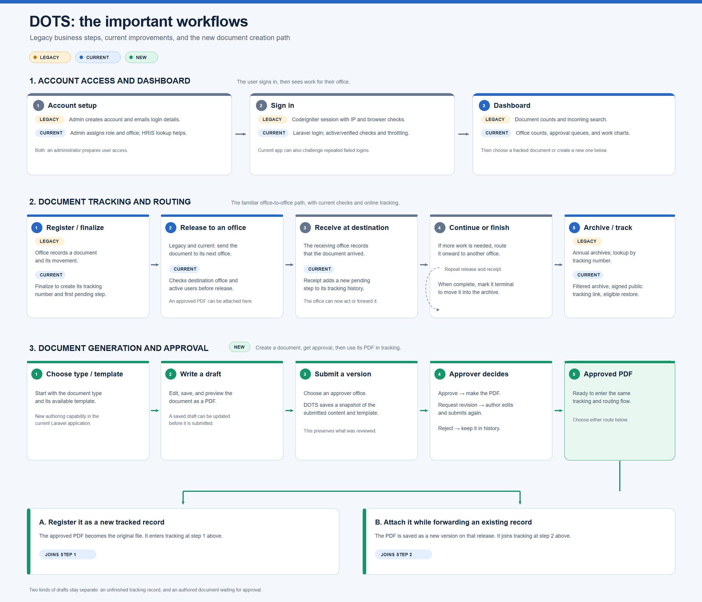

# DOTS Legacy and Current Workflow

**Prepared:** October 20, 2026 (Asia/Manila)  
**Purpose:** Explain how the legacy DOTS workflow relates to the current Laravel application, including which behaviors were retained, modernized, or added.  
**Scope:** Authentication and accounts; dashboard and efficiency analysis; document tracking and routing; document generation, approval, and drafts.

This file combines the legacy business flow and current application updates. The image below summarizes the main steps for presentation. It does not claim that the legacy system and Laravel application run as one deployed system.

## Simplified workflow image

The image highlights the main steps only: account access and dashboard, document tracking and routing, and the new document creation and approval path.

Vector source: [4_IMPORTANT_LEGACY_CURRENT_WORKFLOW.svg](4_IMPORTANT_LEGACY_CURRENT_WORKFLOW.svg)

## Legend

- **Legacy** — behavior described in the CodeIgniter-era analysis.
- **Current** — behavior implemented in the Laravel application.
- **New** — current capability without an equivalent active module in the legacy analysis.
- **Shared workflow** — the business step remains familiar, while the current application changes how it is implemented or protected.

## Combined end-to-end workflow

```mermaid
flowchart TD
    A["Account provisioned<br/>Legacy: administrator creates account and emails login details<br/>Current: administrator manages account; HRIS employee lookup is available"]
    B["User signs in<br/>Legacy: CodeIgniter session and IP/User-Agent check<br/>Current: Laravel authentication, optional reCAPTCHA, account cooldown/lock, active and verified checks"]
    C["Dashboard<br/>Legacy: Pending, Incoming, Released, Terminal counters and incoming search<br/>Current: office-aware counts, approval queues, office-filtered charts and processing metrics"]
    D{"Choose a work path"}

    A --> B --> C --> D

    D -->|Register or route a tracked record| E["Document tracking<br/>Shared workflow: record and follow official documents<br/>Current: searchable office-scoped list, details, latest view, and audit history"]
    E --> F["Document is pending at its current office<br/>Legacy: office document list and trail<br/>Current: finalized record gets a tracking number and initial trail"]
    F --> G["Release to destination office<br/>Shared workflow: record movement and action<br/>Current: destination must be in range and have an active user"]
    G --> H["Document is available to destination<br/>Current: release is a trail event; an approved generated PDF can be added as a new version"]
    H --> I["Authorized receiving user records receipt<br/>Current: receipt creates a pending trail and updates receipt details"]
    I --> J{"Continue routing?"}
    J -->|Yes| F
    J -->|No| K["Current holding office tags document terminal<br/>Legacy: terminal records appear in annual archives<br/>Current: terminal action sets archive state and records audit events"]
    K --> L["Archived tracking record<br/>Current: eligible holding office can restore it with a new trail"]
    L -->|Open tracking link| M["Public tracking<br/>Legacy: lookup by tracking number<br/>Current: finalized record is shown through a signed, rate-limited link"]
    L -->|Restore, if eligible| F

    D -->|Author a new document| N["Choose document type and template<br/>New: versioned template and asset support"]
    N --> O["Write document and save draft<br/>New: rich-text editor, paginated layout, saved draft and PDF preview"]
    O --> P{"Submit this version for approval?"}
    P -->|No| O
    P -->|Yes| Q["Submit a version to an approver office<br/>New: submitted content and template are snapshotted"]
    Q --> R{"Approver decision"}
    R -->|Request revision| O
    R -->|Reject| S["Rejected submission remains in authoring history"]
    R -->|Approve| T["Approved generated document"]
    T --> U["Register as a new tracking record<br/>Generated PDF is saved as the original file"]
    U --> F
    T --> V["Or select it while forwarding an existing record<br/>Generated PDF is saved as a new version on that release trail"]
    V --> H
    O --> W["Optional: archive an authored draft<br/>Current: generated-draft archive has its own restore flow"]
    W --> O
```

## 1. Authentication and accounts

| Legacy workflow | Current workflow and updates |
|---|---|
| An administrator manages accounts through the `UserAccount` module. Account creation sends the user login details by email. | Administrators create and update accounts, assign roles and office/division, manage active state, and can look up employee information through HRIS. |
| Users sign in through the CodeIgniter login module. Sessions record the user ID and bind the session to IP address and User-Agent. | Users sign in through Laravel authentication. Accounts must be active; the main application also requires verified email. Sessions regenerate at login and invalidate at logout. |
| The legacy analysis describes a Google reCAPTCHA v2 check after repeated failed logins. | Optional reCAPTCHA v3 can require a v2 challenge. Failed attempts are tracked per account, with cooldowns and account locking after repeated failures. |
| Password recovery uses the legacy email/token flow. | Laravel provides password reset and password update flows. Imported accounts without a local password can verify credentials with HRIS and then set one. |

**How to explain it:** Account administration and sign-in remain the entry point. The current system adds HRIS-assisted setup and uses Laravel account state and login protections in place of the old session-specific implementation.

## 2. Dashboard and efficiency analysis

| Legacy dashboard | Current dashboard |
|---|---|
| Shows Pending, Incoming, Released, and Terminal counters. The legacy page loads counters through an AJAX call to `Dashboard/loadNotif` and supports incoming-document search. | Shows office-aware incoming, pending, released, and archived counts, plus authored-document approval counts and recent/incoming document lists. |
| Does not describe the current authored-document approval queues or processing-time chart. | Adds document-type charts and processing-time analysis for document routing and approval. Authorized users can filter chart data by office. Chart calculations are deferred so the summary cards render first. |

The current processing chart reports median elapsed weekdays for measurable document receipt-to-release cycles and approval submission-to-decision cycles. It is a workflow duration metric, not a measure of employee working hours; holidays are included in the elapsed weekday calculation.

**How to explain it:** The dashboard keeps the legacy role of summarizing work, then extends it with approval visibility, office-level charts, and processing duration analysis.

## 3. Document tracking and routing

### Shared business flow

1. A user registers or opens a document associated with an NCIP office.
2. The system shows the document's tracking information and transaction history.
3. The current office releases it to another office.
4. An eligible user at the destination records receipt.
5. The document can be routed onward or marked terminal and archived.
6. A tracking page lets a holder of a public tracking link review finalized-document status.

### What changed in the current app

- The legacy `Documents`, `DocumentsAll`, and `LatestDocuments` areas are represented by Laravel document routes and access scopes rather than separate HMVC modules. The main list supports search, status filtering, sorting, paging, details, and a latest-documents view.
- A finalized record receives a generated tracking number and an initial pending trail. A non-finalized tracking record remains a draft.
- Ordinary users see documents associated with their office and routing history. Privileged users can view all-office records and use office filters where provided.
- Release checks the user's current office, the destination office's range, and whether the destination has an active user. Receipt is role-gated and only allowed for a document available to that user's office.
- The legacy application describes a standalone file-upload module and files under the web-root upload directory. Current uploads are integrated with document actions, stored privately, and downloaded through an access-checked route.
- The legacy analysis describes annual archive pages. The current app uses a single filtered archive and supports restoration by the eligible current holding office.
- Legacy public tracking uses a tracking-number lookup. Current public tracking is limited to finalized records and requires a signed, rate-limited URL.
- Audit history is available in the current application and can be filtered by office for users with the required access.

### Generated documents entering tracking

An approved generated document can enter the tracking flow in two ways:

1. **Register as a new record:** DOTS creates a tracking record and stores the generated PDF as its original file. The record then follows the normal release/receipt workflow.
2. **Attach during forwarding:** While forwarding an existing tracking record, a user can choose **Use approved document**. DOTS stores the generated PDF as a new version associated with that release trail. The tracked document keeps its tracking number and existing versions.

**How to explain it:** The core office-to-office routing path is familiar from legacy DOTS. The current app adds stronger office/role checks, protected file downloads, a unified archive, restoration, and a signed public tracking link.

## 4. Document generation, approval, and drafts

The active Laravel app has a separate authoring workflow. It is a new application capability relative to the implemented legacy modules described in `PROJECT_ANALYSIS.md`; older document-generation design and proposal notes are planning references, not proof of a legacy implementation.

1. **Choose a document type and template.** Administrators can assign a default template version to a document type.
2. **Write and save a draft.** Authors use the rich-text editor and paginated writing surface. Draft content can be previewed as PDF without saving a new draft.
3. **Submit a version.** The author selects an approver office. Submitted content and template details are retained as a version snapshot. Email notification to approvers is optional.
4. **Review the submission.** An eligible approver can approve, reject, or request revisions.
5. **Handle the decision.** A revision request returns the draft to the author for editing and resubmission. A rejection remains in the authoring history. An approval makes the generated document available for registration or reuse while forwarding.
6. **Archive authoring work if needed.** Generated drafts have an archive view and restore flow, separate from the tracking-record archive.

### Keep the two kinds of drafts distinct

- **Tracking draft:** an ordinary `documents` record saved without finalization. It does not yet follow the finalized routing path.
- **Generated-document draft:** a `document_creation_drafts` record containing authored content and an approval/version history. When approved, it can produce a PDF and enter the tracking workflow.

**Workflow boundary:** The source includes `awaiting_verification` and `verified` values in some data and UI paths, but the inspected routes do not expose a separate verification action. Present the implemented decision path as **approve / request revision / reject**, and describe verification as a reserved or incomplete step.

## Presentation summary

> A user signs in and reviews an office-aware dashboard. They either register or route a tracked document directly, or author a new document and send a version for approval. Once approved, generated output becomes a new tracked record or a version attached during forwarding. Both paths use the same office routing lifecycle: release, receive, route onward, then terminal/archive when complete.

## Source references

- Legacy behavior: [PROJECT_ANALYSIS.md](PROJECT_ANALYSIS.md)
- Current implementation summary: [PROJECT_CURRENT_STATE_2026-10-20.md](PROJECT_CURRENT_STATE_2026-10-20.md)
- Legacy/current comparison: [LEGACY_TO_CURRENT_COMPARISON_2026-10-20.md](LEGACY_TO_CURRENT_COMPARISON_2026-10-20.md)
- Current routes: [routes/web.php](../routes/web.php), [routes/auth.php](../routes/auth.php)
- Current workflow controllers: [DocumentController.php](../app/Http/Controllers/DocumentController.php), [DocumentCreationController.php](../app/Http/Controllers/DocumentCreationController.php), [DashboardController.php](../app/Http/Controllers/DashboardController.php)
- Current workflow services: [DocumentAccess.php](../app/Services/DocumentAccess.php), [DashboardCharts.php](../app/Services/DashboardCharts.php), [ProcessingPerformance.php](../app/Services/ProcessingPerformance.php)
