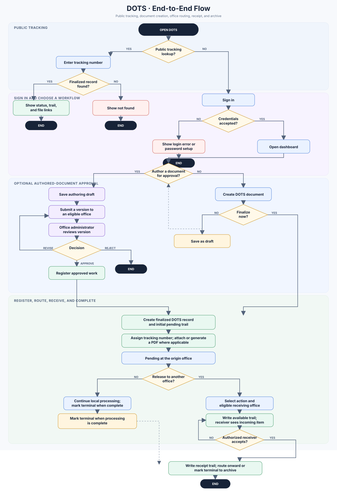
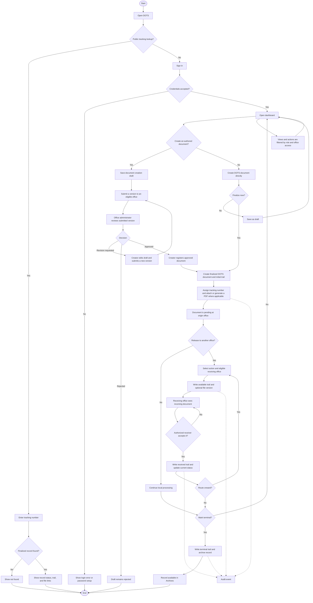

# DOTS System Analysis and End-to-End Flow

**Reviewed:** 13 October 2026  
**Scope:** Current Laravel application in this repository. This is a source-code review, not a production deployment or database audit.

## 1. Executive summary

DOTS is an office-based document registration, routing, receipt, tracking, and archive system. It also includes a separate document-authoring workflow with draft versions and office-admin approval. The current application is built on Laravel 12, PHP 8.2+, Inertia.js, React/TypeScript, and a relational database accessed through Eloquent.

The main operational record is `documents`. Its `document_trails` record each dispatch, receipt, and terminal action; `document_files` links attachments and versions to documents and, where applicable, a trail. `audit_trails` records application events for review. Office and document-type libraries provide reference data. Legacy import services and legacy models support transition from earlier data sources.

At a high level, a staff member signs in, registers or creates a document, then routes it to another office. The receiving office records receipt, can route it onward, and may mark it terminal when processing is complete. Authenticated users can view documents in their access scope; finalized records can also be looked up through a public tracking-number page. Archived documents are searchable in the archive module.

## 2. Application structure

```text
Browser (React + TypeScript)
  -> Laravel web routes and middleware
  -> Controllers and application services
  -> Eloquent models / relational database
  -> Inertia page response and shared props
  -> React page update
```

- **Backend:** Laravel 12, PHP 8.2+, Eloquent, Laravel authentication, Dompdf, Excel support, and Spatie permission package.
- **Frontend:** React 18, TypeScript, Inertia 2, Vite, Tailwind CSS, and Ziggy route data.
- **Persistence:** migrations define the current tables; configuration supports a MySQL-style production database and a local SQLite setup.
- **Files:** document files are stored on Laravel's `public` disk, with metadata in `document_files`.
- **External systems:** HRIS directory/credential lookups and connected-system views for DRIP, iPluma, and PDMIS. Credentials and endpoints are supplied through environment-backed configuration.

## 3. Main modules

| Module | Purpose |
| --- | --- |
| Authentication and profile | Login, logout, password reset/change, email verification, and account profile. Login may verify credentials against HRIS, depending on configuration. |
| Dashboard | Office-scoped or privileged counts, incoming documents, approval counts, charts, and processing summaries. |
| Documents | Search and view documents, create/finalize records, attach files, release to another office, receive incoming records, edit allowed metadata, and tag records terminal. |
| Document Creation | Save an authored document draft, submit a version for approval, record an approval/revision/rejection decision, and register approved work as an official DOTS document. |
| Archives | Paginated, filtered view of records whose `is_archived` flag is true. |
| Public tracking | Read-only lookup by tracking number for finalized records, including trail and file metadata. |
| Audit trail | Review logged actions, actor and office context, and imported audit records. |
| Setup/libraries | Administrator-facing office, range, document type, action type, purpose type, and user-account maintenance. |
| Connected systems | Screens and controller integrations for HRIS, DRIP, iPluma, and PDMIS. |
| Legacy import | Artisan commands preview or apply directory, document, and audit imports and emit JSON reports. |

## 4. Roles and access

The authenticated application routes require both `auth` and `verified`. Setup and library/account routes are grouped under an `administrator` middleware alias. The alias currently calls `User::canManageLibraries()`; document approval and other checks also call `User::isAdministrator()`. These methods use different role ID sets, so role configuration should be reviewed against the intended policy.

`DocumentAccess` provides the shared document visibility scope. Users with configured all-document access can see all records. Other users are scoped to documents associated with their office through the owning office or trail office fields, plus specific legacy and draft ownership cases. The dashboard, document pages, and archive use this service to build their queries. Archive office filtering is only offered to users with all-document access.

Receiving is role-gated through `canReceiveDocuments()`. Releasing and terminal tagging require the current user to be the document's current holder. Receipt requires the latest trail to be `available` for the user's office. Legacy records marked as needing review and archived records are blocked from routine receive/release actions.

## 5. Core data model

- **`users`** — identity, role, active/locked state, HRIS fields, and office/division assignment.
- **`offices`, `divisions`, `ranges`** — organizational context and routing boundaries.
- **`documents`** — title, tracking number, type/purpose/action metadata, origin, owning office, creator, status, finalization/archive flags, and legacy identity/review fields.
- **`document_trails`** — chronological routing events, source/destination/holder office references, action, status, remarks, and actor.
- **`document_files`** — stored path, original name, MIME type, size, file type (original/version), uploader, and optional associated trail.
- **`document_creation_drafts`, `document_creation_versions`, `document_creation_events`** — authoring content, submission snapshots, workflow decisions, and event history.
- **`audit_trails`** — action, actor/office snapshot, subject model, details, result, IP address, and user agent.
- **Reference tables:** `document_types`, `action_types`, `purpose_types`.
- **Legacy compatibility:** legacy model adapters and import identity/source columns preserve links to historical records.

The document's current display status is often derived from its latest trail, while `documents.status` also stores a current value. Keep those values synchronized when adding workflow transitions. Archiving is currently represented by `documents.is_archived`; terminal tagging sets both status to `terminal` and the archive flag.

## 6. End-to-end flowchart

The flow below combines the normal routing path with the optional authored-document approval path. A user may create a regular DOTS document directly or complete the approval path first and then register it.



The standalone, scalable image is also available at [SYSTEM_FLOWCHART.svg](SYSTEM_FLOWCHART.svg).



## 7. Workflow details

### Standard registration and routing

1. A signed-in user submits document metadata and, optionally, an attachment. The application assigns the current office and creator.
2. The record starts with a temporary identifier, then receives a tracking number based on office prefix, date, and document ID. Attachments are optional; the approved-draft path can generate a PDF.
3. Finalized documents receive an initial `pending` trail. Non-finalized entries are saved with `draft` status.
4. To release, the current holder selects an action and a destination office within the assigned range. The destination must have an active user. The app writes an `available` trail and updates document status.
5. An eligible receiving user can receive the document only when the latest trail is `available` and addressed to that user's office. The app writes a `pending` receipt trail and updates receipt metadata.
6. The receiving office may repeat the release/receive cycle. A current holder may mark the record terminal; this writes a terminal trail and sets `is_archived`.

### Authored-document approval

1. The creator saves structured document content as a draft.
2. On submission, the app snapshots the content into `document_creation_versions`, increments the version, and assigns an approver office with an active administrator.
3. An eligible office administrator records `approved`, `revision_requested`, or `rejected` for the submitted version. Stale version decisions are rejected.
4. The creator can resubmit a revision. Approved work can be registered as a DOTS document and later selected while forwarding a document.

The schema and UI contain fields for verification and `awaiting_verification`/`verified` statuses, but the inspected routes/controller do not expose a distinct verification action. Treat verification as a reserved or incomplete workflow step unless another module implements it.

## 8. Important implementation observations

1. **Role policy has multiple definitions.** Route middleware uses `canManageLibraries()` (role IDs 1 and 2), while approval paths use `isAdministrator()` (IDs 1 and 3 plus role names). Aligning these mappings would make setup and approval permissions easier to reason about.
2. **Status is stored in two places.** Both document and trail rows carry status, and pages may use the latest trail for display. New transitions should update both consistently and should be transactional.
3. **Files use the public storage disk.** Public tracking serializes file URLs for finalized documents. This makes attachment visibility dependent on how `DocumentFile::downloadUrl()` and public storage are configured; verify that each exposed file is intended for public access.
4. **Verification appears unfinished.** Verification-related columns and status handling are present, but there is no distinct verification endpoint in the inspected route set.
5. **Audit coverage is explicit.** Important events are recorded through `AuditTrailWriter`, but this is application-level coverage; confirm that every sensitive mutation has a corresponding audit event.
6. **External-service availability is configuration-dependent.** HRIS can use fixture data in configured sample mode; production lookups otherwise rely on configured API URLs/credentials. Connected-system endpoints similarly depend on environment configuration.
7. **The README is still Laravel boilerplate.** Project setup and operational workflows are not documented there; this analysis is intended as a code-oriented orientation document.

## 9. Key source locations

- Routes: `routes/web.php`, `routes/auth.php`
- App bootstrap/middleware: `bootstrap/app.php`, `app/Http/Middleware/`
- Main workflows: `app/Http/Controllers/DocumentController.php`, `DocumentCreationController.php`, `ArchiveController.php`
- Reporting and access: `DashboardController.php`, `AuditTrailController.php`, `app/Services/DocumentAccess.php`
- Public tracking: `PublicDocumentTrackingController.php`
- Audit and HRIS: `app/Services/AuditTrailWriter.php`, `HrisDirectory.php`
- Models and migrations: `app/Models/`, `database/migrations/`
- UI pages: `resources/js/Pages/`
- Legacy import: `app/Console/Commands/ImportLegacy*.php`, `app/Services/Legacy*Import.php`

## 10. Review limits

This overview is based on the checked-in routes, controllers, models, migrations, services, and frontend page structure. It does not inspect a live database, `.env` values, production permissions, deployed storage ACLs, or external API behavior. The flowchart represents application paths found in source and does not claim every operational exception or deployment-specific integration.
