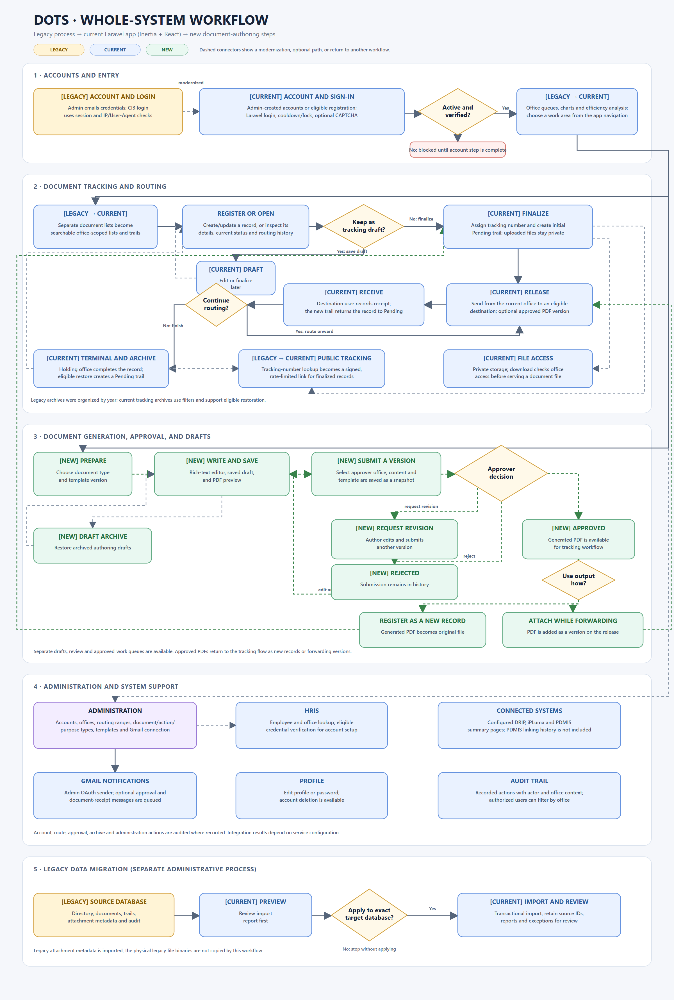
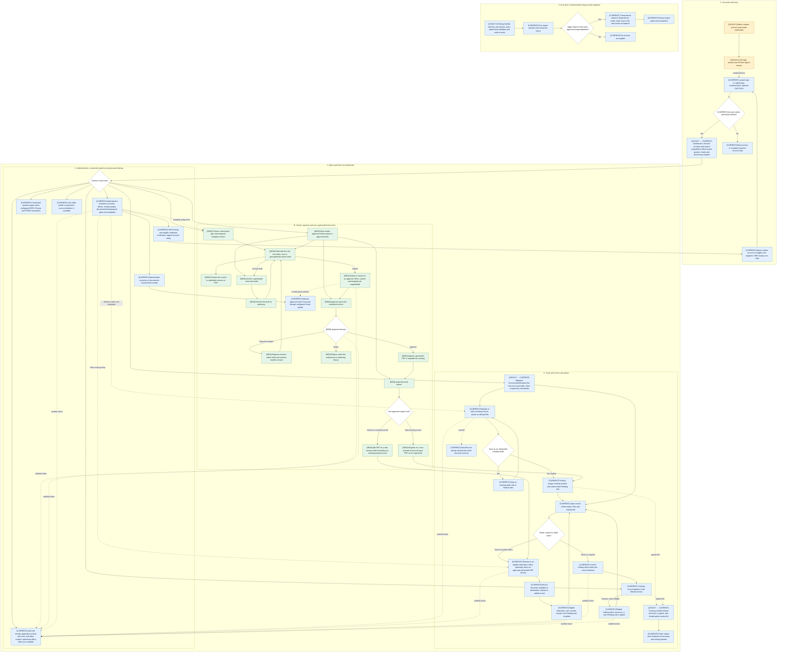

# DOTS Whole-System Workflow: Legacy and Current

## Simplified image

This overview shows the main user journey and supporting modules. It leaves detailed rules and edge cases to the workflow and notes below.

Vector source: [WHOLE_SYSTEM_WORKFLOW_SIMPLE.svg](WHOLE_SYSTEM_WORKFLOW_SIMPLE.svg)

## Detailed workflow image

Editable vector: [WHOLE_SYSTEM_LEGACY_AND_CURRENT_WORKFLOW.svg](WHOLE_SYSTEM_LEGACY_AND_CURRENT_WORKFLOW.svg)

**Prepared:** October 20, 2026 (Asia/Manila)  
**Purpose:** Explain the complete DOTS journey, showing how the legacy CodeIgniter workflow maps to current Laravel features and where new capabilities were added.  
**Scope:** User access, dashboard, document tracking and routing, document authoring and approval, archives, audit, administration, connected systems, personal settings, and legacy data import.

This is a combined business-flow view for presentation. The legacy labels describe the former system; they do not mean the legacy and Laravel applications run together. The active workflow is the **Current** path, with **New** marking capabilities that have no equivalent implemented legacy module in the project analysis.

The current user-facing screens use Inertia and React; the diagram groups them by the work users perform.

## Legend

- **[LEGACY]** — behavior described in the CodeIgniter-era project analysis.
- **[CURRENT]** — behavior implemented in this Laravel application.
- **[NEW]** — a current capability without an equivalent implemented legacy module.
- Dashed arrows show a related or supporting path, such as a modernization note, optional notification, or audit event.
- The workflow is a presentation-level overview. Detailed access rules and implementation limits follow the diagram.

## Combined whole-system Mermaid workflow

## 1. Authentication and accounts

| Legacy workflow | Current workflow and updates |
|---|---|
| An administrator manages accounts through the `UserAccount` module. Account creation sends login details by email. | Administrators create and update accounts, assign roles and office/division, manage active state, and can look up employee information through HRIS. Registration routes are also present for eligible users. |
| Users sign in through CodeIgniter. The legacy analysis describes sessions bound to IP address and User-Agent. | Laravel handles sign-in and session regeneration. Operational routes require an active, verified account. Failed attempts are tracked per account, with cooldowns and account locking after repeated failures. Optional reCAPTCHA v3 can require a v2 challenge. |
| Password recovery follows the legacy email/token flow. | Laravel provides password reset, password update, password confirmation, and email verification flows. Eligible imported accounts without a local password can verify credentials with HRIS and then set one. |

**How to explain it:** Account setup and sign-in remain the entry point. The current application adds HRIS-assisted account setup and Laravel account checks and login protections.

## 2. Dashboard and efficiency analysis

| Legacy dashboard | Current dashboard |
|---|---|
| Shows Pending, Incoming, Released, and Terminal counters. The legacy page loads counters through an AJAX call to `Dashboard/loadNotif` and supports incoming-document search. | Shows office-aware incoming, pending, released, and archived counts, plus authored-document approval counts and recent/incoming document lists. |
| Does not describe the current authored-document approval queues or processing-time chart. | Adds document-type charts and processing-time analysis for document routing and approval. Authorized users can filter chart data by office. Chart calculations are deferred so summary cards render first. |

The current processing chart reports median elapsed weekdays for measurable document receipt-to-release cycles and approval submission-to-decision cycles. It is a workflow duration metric, not a measure of employee working hours; holidays are included in the elapsed weekday calculation.

## 3. Document tracking and routing

### Shared business flow

1. A user registers or opens a document associated with an NCIP office.
2. The system shows the document's tracking information and transaction history.
3. The current office releases it to another office.
4. An eligible user at the destination records receipt.
5. The document can be routed onward or marked terminal and archived.
6. A finalized record can be viewed using its signed public tracking link.

### What changed in the current app

- The legacy `Documents`, `DocumentsAll`, and `LatestDocuments` areas are represented by Laravel document routes and access scopes rather than separate HMVC modules. The main list supports search, status filtering, sorting, paging, details, and a latest-documents view.
- A finalized record receives a generated tracking number and an initial pending trail. A non-finalized tracking record remains a draft.
- Ordinary users see documents associated with their office and routing history. Privileged users can view all-office records and use office filters where provided.
- Release checks the user's current office, the destination office's range, and whether the destination has an active user. Receipt is role-gated and only allowed for a document available to that user's office.
- New uploads are integrated with document actions, stored privately, and downloaded through an access-checked route. The legacy analysis describes a separate file-upload module and files under the web-root upload directory.
- The legacy analysis describes annual archive pages. The current app uses a filtered archive and supports restoration by the eligible current holding office.
- Legacy public tracking uses a tracking-number lookup. Current public tracking is limited to finalized records and requires a signed, rate-limited URL.
- Audit history is available in the current application and can be filtered by office for users with the required access.

### Generated documents entering tracking

An approved generated document can enter the tracking flow in two ways:

1. **Register as a new record:** DOTS creates a tracking record and stores the generated PDF as its original file. The record then follows the normal release/receipt workflow.
2. **Attach during forwarding:** While forwarding an existing tracking record, a user can choose **Use approved document**. DOTS stores the generated PDF as a new version associated with that release trail. The tracked document keeps its tracking number and existing versions.

## 4. Document generation, approval, and drafts

Document authoring and approval is a new application capability relative to the implemented legacy modules described in `PROJECT_ANALYSIS.md`. Older design notes are planning references, not proof of a legacy implementation.

1. **Choose a document type and template.** Administrators can assign a default template version to a document type. Templates and assets are versioned.
2. **Write and save a draft.** Authors use the rich-text editor and paginated writing surface. Draft content can be previewed as PDF without saving a new draft.
3. **Submit a version.** The author selects an approver office. Submitted content and template details are retained as a version snapshot. Email notification to approvers is optional.
4. **Review the submission.** An eligible approver can approve, reject, or request revisions.
5. **Handle the decision.** A revision request returns the draft to the author for editing and resubmission. A rejection remains in the authoring history. An approval makes the generated document available for registration or reuse while forwarding.
6. **Archive authoring work if needed.** Generated drafts have an archive view and restore flow, separate from the tracking-record archive.

### Keep the two kinds of drafts distinct

- **Tracking draft:** an ordinary `documents` record saved without finalization. It does not yet follow the finalized routing path.
- **Generated-document draft:** a `document_creation_drafts` record containing authored content and an approval/version history. When approved, it can produce a PDF and enter the tracking workflow.

**Workflow boundary:** The source includes `awaiting_verification` and `verified` values in some data and UI paths, but the inspected routes do not expose a separate verification action. Present the implemented decision path as **approve / request revision / reject**, and describe verification as a reserved or incomplete step.

## 5. Administration, integrations, profile, audit, and migration

### Administration and reference libraries

Administrator-protected features include:

- User account creation and updates, including role, office/division assignment, active state, and HRIS employee lookup.
- Offices and routing ranges.
- Document types, action types, and purpose types.
- Document type template assignment and template asset/version management.
- Gmail sender connection and disconnection through Google OAuth.

These settings supply the accounts, routing destinations, and form/template choices used by the operational workflows.

### Connected systems and notifications

- `/connected-systems` links to the configured DRIP, iPLuma, and PDMIS summary pages. Their availability and results depend on endpoint and credential configuration.
- HRIS supports employee/office lookup and credential verification for eligible imported accounts.
- Gmail OAuth supplies the system sender for optional approval and document-receipt notices. Delivery also depends on queue and runtime configuration.
- The current PDMIS page shows configured summaries. The legacy DOTS-to-PDMIS document linking, suggestions, and link-history workflow is not present in the inspected Laravel routes.

### Profile and audit

- The profile area supports profile edits, password updates, and account deletion through Laravel's profile flow.
- Audit records capture application activity with actor and office context, including authentication, document routing, approval, account/library, and import events where recorded. Authorized users can filter audit history by office.

### Legacy-data import

The repository includes preview/apply Artisan commands for legacy directory data, documents and trails, attachment metadata, and audit history. Apply mode requires the exact target database name and uses transactional writes. Imports retain source identifiers and produce reports; exceptions can be kept for review. The document import currently imports attachment metadata but does not copy the physical legacy file binaries into private storage. This is a controlled administrative migration path, not a normal user-facing document workflow.

## 6. Security and data-handling checkpoints

- Operational web routes require authentication, an active account, and verified email; administration routes add administrator authorization.
- Document visibility is scoped by office and routing history. Release, receipt, terminal tagging, and restore actions apply role and current-office checks.
- Public tracking only exposes finalized records through signed, rate-limited links.
- New document files are stored privately and downloaded only after access checks.
- Import apply mode is guarded by preview, exact target-database confirmation, and transactions.
- Gmail OAuth state is validated and stored tokens are encrypted. Rich-text content and template assets are validated before PDF rendering.

## Presentation summary

> A user enters DOTS through account access and an office-aware dashboard. They either register and route a tracked document, or author a new document and send it for approval. Approved output can become a new tracking record or an attached version during forwarding. Documents move between offices through release and receipt, then reach terminal/archive status when work is complete. Administrators maintain the directory and reference data, connected-system pages show configured summaries, and audit trails capture recorded actions. Legacy records can be imported through a separate guarded migration process.

## Source references

- Legacy behavior: [PROJECT_ANALYSIS.md](PROJECT_ANALYSIS.md)
- Current implementation summary: [PROJECT_CURRENT_STATE_2026-10-20.md](PROJECT_CURRENT_STATE_2026-10-20.md)
- Legacy/current comparison: [LEGACY_TO_CURRENT_COMPARISON_2026-10-20.md](LEGACY_TO_CURRENT_COMPARISON_2026-10-20.md)
- Change inventory: [PROJECT_CHANGES_FROM_LEGACY_2026-10-20.md](PROJECT_CHANGES_FROM_LEGACY_2026-10-20.md)
- Current routes: [routes/web.php](../routes/web.php), [routes/auth.php](../routes/auth.php)
- Tracking and authoring: [DocumentController.php](../app/Http/Controllers/DocumentController.php), [DocumentCreationController.php](../app/Http/Controllers/DocumentCreationController.php)
- Dashboard and access: [DashboardController.php](../app/Http/Controllers/DashboardController.php), [DocumentAccess.php](../app/Services/DocumentAccess.php)
- Integrations and imports: [IntegrationController.php](../app/Http/Controllers/IntegrationController.php), [app/Console/Commands](../app/Console/Commands/)

