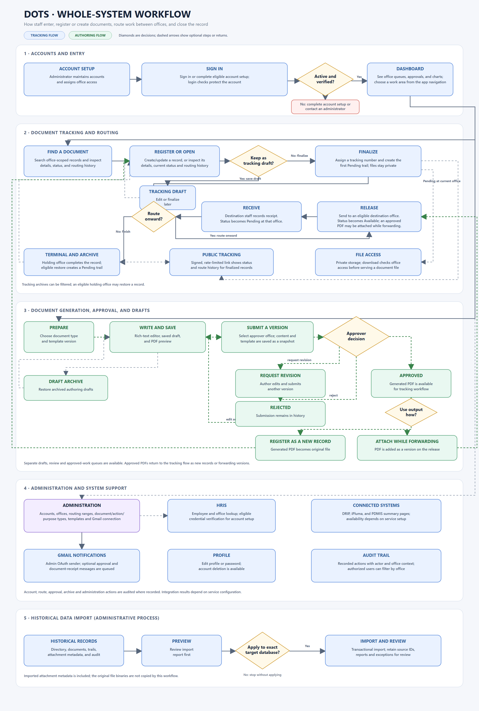
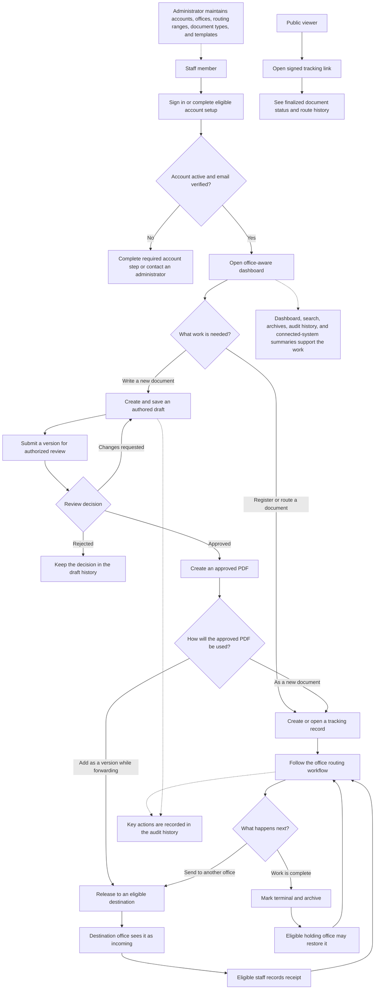
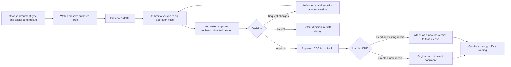

# DOTS Whole-System Workflow

**Reviewed:** October 20, 2026 (Asia/Manila)  
**Purpose:** Explain how people use DOTS, how a document moves through the system, and how the supporting parts fit together.

Open the [scalable SVG source](WHOLE_SYSTEM_WORKFLOW.svg) to zoom in or print it.

## DOTS in one sentence

DOTS helps staff create or register a document, send it between offices, record each handoff, and keep its final status and history available for review.

## The simple story

1. An administrator maintains accounts, offices, routing ranges, document choices, and writing templates.
2. A staff member signs in and sees a dashboard for work connected to their office and permissions.
3. The staff member either registers a document that already exists or writes a new document for review.
4. A registered document is routed office to office. Each release and receipt updates its status and history.
5. When work is complete, the holding office archives the record. Authorized staff can later find and restore it.
6. A person with a signed tracking link can check the status and route history without signing in.

## Whole-system map

## 1. People enter DOTS

- **Staff:** Sign in. The application checks that the account is active and the email is verified before showing the operational pages. Some accounts can use HRIS to confirm employee details or complete password setup.
- **Administrators:** Create and maintain accounts, assign roles and offices, and manage the reference information used by the rest of the system.
- **Public viewers:** Do not sign in. They open a signed tracking link and see selected information about a finalized document and its route history.

After staff sign in, the dashboard gives them a starting point. It shows office-scoped or authorized all-office counts, recent and incoming documents, approval work, and workflow charts. Search, filters, and detail pages help staff find the record they need.

## 2. Register and route a tracked document

This is the main path for documents that need an official DOTS tracking number.

```mermaid
flowchart LR
    START[Enter document details and optional file] --> SAVE{Finalize now?}
    SAVE -->|No| DRAFT[Save tracking draft]
    DRAFT --> EDIT[Edit later and finalize when ready]
    EDIT --> FINAL
    SAVE -->|Yes| FINAL[Assign tracking number and create initial Pending history]
    FINAL --> HOLDER[Current office processes the document]
    HOLDER --> NEXT{Send onward or finish?}
    NEXT -->|Send onward| RULES[Check sender's holding office, routing range, and destination eligibility]
    RULES --> RELEASE[Record release; status becomes Available at destination]
    RELEASE --> INBOX[Destination office sees incoming document]
    INBOX --> RECEIPT[Eligible staff records receipt]
    RECEIPT --> HOLDER2[Status becomes Pending at receiving office]
    HOLDER2 --> NEXT
    NEXT -->|Finish| TERMINAL[Mark terminal and archive]
    TERMINAL --> ARCHIVE[Find in Archives]
    ARCHIVE -->|If eligible| RESTORE[Restore; create a new Pending history entry]
    RESTORE --> HOLDER
```

### What happens at each step

1. **Enter the record.** Staff choose document details such as type, action, purpose, origin, urgency, and remarks. They may attach a file. New files are stored privately and downloaded through an access-checked route.
2. **Save or finalize.** A saved tracking draft can be edited later. Finalizing assigns the tracking number and creates the first `Pending` trail entry.
3. **Work at the current office.** The holding office can review the record, update allowed details, and release it onward. DOTS checks that the user is acting from the current holding office, that the destination is in their routing range, and that the destination can receive work.
4. **Release and receive.** Releasing creates an `Available` trail for the destination. An eligible user at that destination records receipt, which creates a new `Pending` trail there. The same release-and-receive cycle can repeat across offices.
5. **Finish or restore.** The current holding office can mark the document terminal. DOTS archives it. An eligible holding office can restore it later, which clears the archive state and adds a new `Pending` trail entry.

The trail is the chronological history of handoffs and actions. The document record stores its current summary; its status should stay in step with the latest trail.

## 3. Write, review, and use an authored document

This path is for creating a new document inside DOTS. It is separate from a tracking draft.

1. The author chooses a document type and its assigned template, writes in the editor, and saves a generated-document draft. The author can preview a PDF before submitting.
2. Submitting creates a saved version of the content and template and sends it to an authorized reviewer at the selected office. The author can request an optional email notice.
3. The reviewer approves, rejects, or requests changes. A request for changes returns the draft to the author for another version. A rejection remains in the history.
4. After approval, the PDF can become the original file on a new tracking record, or a new version attached to an existing tracking record as it is released.
5. Authored drafts can be archived and restored from their own draft archive. This is separate from the archive for tracked documents.

## 4. Supporting work around the document flows

| Supporting area | What it does |
| --- | --- |
| Dashboard | Summarizes office work, incoming documents, approval queues, and workflow performance. |
| Search and details | Find tracking records and inspect their metadata, files, status, and trail. |
| Archives | Find terminal tracking records, filter them, and restore records when allowed. |
| Audit history | Review recorded actions with actor and office context. |
| Account and office setup | Maintain users, roles, office structure, divisions, and routing ranges. |
| Document libraries | Maintain the document types, actions, and purposes used in forms. |
| Templates | Assign and maintain versioned templates and assets used for authored documents. |
| Connected systems | Show configured summaries from DRIP, iPluma, and PDMIS. These pages depend on their external endpoints and credentials. |
| HRIS | Support employee lookup and credential verification for eligible account setup or sign-in paths. |
| Gmail | Provide the configured sender for optional approval and receipt notices. Sending depends on the Gmail connection and runtime configuration. |
| Historical data import | Administrators can preview an import, confirm the exact target database, apply records in dependency order, and review a report of results and exceptions. Imported attachment metadata does not copy the original file binaries. |

These areas support the main work. For example, offices and routing ranges determine where a document can go; templates shape authored documents; access rules determine which records a user can see or change; audit entries help explain what happened.

## 5. Two kinds of drafts

| Draft | What it contains | What makes it part of the tracking flow? |
| --- | --- | --- |
| **Tracking draft** | A document record with tracking details that is not finalized yet. | Finalizing assigns a tracking number and creates the initial `Pending` trail. |
| **Authored-document draft** | Written content, template information, saved versions, and review decisions. | Approval makes a PDF available to register as a new tracking record or attach during release. |

Remember: **the authored draft creates the document; the tracking record follows where the document goes.**

## 6. Status words in plain language

| Status | Plain meaning |
| --- | --- |
| `Draft` | Saved but not finalized as an official tracking record, or authored work that has not been submitted. |
| `Pending` | The current office has received the record and has work to do. |
| `Available` | The record has been released and is waiting at the destination office to be received. |
| `Terminal` | The current office marked processing complete; the tracking record is archived. |
| `Pending approval` | An authored-document version is waiting for review. |
| `Revision requested` | The author needs to revise and submit another version. |
| `Approved` / `Rejected` | The reviewer accepted or declined the submitted authored-document version. |

The interface and database contain some verification-related labels, but the reviewed routes do not provide a separate verification action. The normal review steps to explain are **approve, request changes, or reject**.

## A short explanation you can give someone

> “DOTS starts with a staff dashboard. Staff either register a document or write one for approval. Once a document is registered, DOTS gives it a tracking number and records every office handoff: the sending office releases it, the receiving office confirms receipt, and the process repeats until the holding office marks it complete and archives it. Administrators maintain the offices, users, routing rules, and templates; audit history and public tracking links make the document’s progress easier to review.”

## Where the workflow is implemented

- Routes and entry points: [`routes/web.php`](../routes/web.php), [`routes/auth.php`](../routes/auth.php)
- Tracking, release, receipt, and terminal actions: [`DocumentController.php`](../app/Http/Controllers/DocumentController.php)
- Authoring and approval: [`DocumentCreationController.php`](../app/Http/Controllers/DocumentCreationController.php)
- Dashboard and access scope: [`DashboardController.php`](../app/Http/Controllers/DashboardController.php), [`DocumentAccess.php`](../app/Services/DocumentAccess.php)
- Archives and public tracking: [`ArchiveController.php`](../app/Http/Controllers/ArchiveController.php), [`PublicDocumentTrackingController.php`](../app/Http/Controllers/PublicDocumentTrackingController.php)
- Full code-based reference: [`PROJECT_CURRENT_STATE_2026-10-20.md`](PROJECT_CURRENT_STATE_2026-10-20.md)
